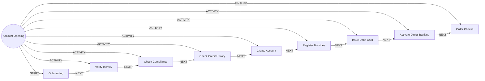

# Account Opening

> Takes a prospect from application to an active account, debit card and digital access.

## Use this process when
- open an account
- new savings or current account
- sign up as a customer
- onboard a new customer

## Do not use it when
- loan or credit request: use [Loan Origination](loan-origination.md)
- fixed or recurring deposit: use [Term Deposit Lifecycle](term-deposit-lifecycle.md)
- refresh KYC of an existing customer: use [Perpetual KYC](perpetual-kyc.md)

## Trigger and ownership
- **Triggered by:** [Application submitted](../events.md#evt.application_submitted)
- **Performed by:** [Onboarding Agent](../actors/agents.md#actor.onboarding_agent) (autonomy ceiling A3)
- **Escalates to:** [Compliance Officer](../actors/humans-and-external.md#actor.compliance_officer), [Service Officer](../actors/humans-and-external.md#actor.service_officer)
- **Emits:** [Account opened](../events.md#evt.account_opened)
- **Governed by:** [Consent and Privacy](../policies/consent-and-privacy.md), [Agent Guardrails](../policies/agent-guardrails.md), [Authentication Assurance](../policies/authentication-assurance.md), [Approval Matrix](../policies/approval-matrix.md), [Audit and Evidence](../policies/audit-and-evidence.md)

## Flow
Work the steps in order. At each step, open the linked activity file before acting. A step marked conditional is skipped when its condition is false, and the skip is recorded.

| # | Step | Edge | Activities | Performed by | Approval gate | Autonomy | Condition | What happens |
|---|---|---|---|---|---|---|---|---|
| 1 | **Onboarding** | START | [Check Consent](../activities/check-consent.md) | [Onboarding Agent](../actors/agents.md#actor.onboarding_agent) | none | A3 | always | Capture applicant details, product choice, nominee and consents. Create the application record and a prospect customer. |
| 2 | **Verify Identity** | ACTIVITY | [Verify Identity](../activities/verify-identity.md) | [Onboarding Agent](../actors/agents.md#actor.onboarding_agent) | none | A3 | always | Verify identity by eKYC or documents. |
| 3 | **Check Compliance** | ACTIVITY | [Screen Sanctions and PEP](../activities/screen-sanctions-pep.md), [Risk-Rate Customer](../activities/risk-rate-customer.md) | [Onboarding Agent](../actors/agents.md#actor.onboarding_agent) | [Compliance Officer](../actors/humans-and-external.md#actor.compliance_officer) (only when a potential screening match or a high-risk rating) | A3; A2 when gated | always | Screen sanctions and PEP, then rate risk. A potential match or high rating goes to the compliance officer. |
| 4 | **Check Credit History** | ACTIVITY | [Pull Credit Bureau](../activities/pull-credit-bureau.md) | [Onboarding Agent](../actors/agents.md#actor.onboarding_agent) | none | A3 | Only if the product has a credit feature (overdraft, credit card). | Pull bureau data with credit_check consent. |
| 5 | **Create Account** | ACTIVITY | inline | [Onboarding Agent](../actors/agents.md#actor.onboarding_agent) | none | A3 | always | Create the customer record if new, open the account under the product, branch, rate card and GL control account, and set holders. |
| 6 | **Register Nominee** | ACTIVITY | inline | [Onboarding Agent](../actors/agents.md#actor.onboarding_agent) | none | A3 | always | Record nominee details and shares. Guardian required for a minor nominee. |
| 7 | **Issue Debit Card** | ACTIVITY | inline | [Onboarding Agent](../actors/agents.md#actor.onboarding_agent) | none | A3 | always | Request a debit card linked to the account with default limits. |
| 8 | **Activate Digital Banking** | ACTIVITY | [Authenticate (Step-Up)](../activities/authenticate-step-up.md) | [Onboarding Agent](../actors/agents.md#actor.onboarding_agent) | none | A3 | always | Create app login and bind the customer's device. |
| 9 | **Order Checks** | FINALIZE | [Notify Customer](../activities/notify-customer.md) | [Onboarding Agent](../actors/agents.md#actor.onboarding_agent) | none | A3 | always | Order a chequebook if requested, send the welcome notice and emit account_opened. |

## Graph edges
`proc.account_opening` is the hub. Edges follow the hub-and-spoke pattern: the hub STARTs the first step, has an ACTIVITY edge to each middle step, FINALIZEs the last, and steps chain with NEXT.

## Exceptions
| If | Then |
|---|---|
| Identity verification fails | Route to manual review. Do not continue to compliance until resolved. |
| Confirmed or potential sanctions match | Stop. Escalate to the compliance officer. Tell the customer only that the application needs more review (no tipping off). |
| High risk rating | Require enhanced due diligence and compliance officer approval before Create Account. |
| Applicant abandons | Expire the application after the configured number of days and delete uncommitted documents per retention rules. |

## Finalize (done means)
Account is active, card issued, nominee recorded, welcome sent and outcome stored.

## Data touched
| Object | Access | Backing tables |
|---|---|---|
| [Customer](../objects/customer.md#obj.customer) | reads and writes | `bank_customers`, `core_customer_contacts`, `bank_preferences`, `app_users` |
| [Document](../objects/customer.md#obj.document) | reads | `documents`, `los_application_documents`, `ins_claim_documents`, `ret_statements` |
| [Product](../objects/engagement.md#obj.product) | reads | `core_products`, `core_interest_rates`, `core_fee_schedules`, `los_loan_products`, `ins_products` |
| [Consent](../objects/customer.md#obj.consent) | reads | `consents`, `bank_preferences` |
| [KYC Record](../objects/customer.md#obj.kyc_record) | writes | `core_kyc_records`, `ekyc_sessions` |
| [Account](../objects/accounts-payments.md#obj.account) | writes | `bank_accounts`, `core_account_holders`, `gl_account_balances`, `ret_nominees` |
| [Card](../objects/accounts-payments.md#obj.card) | writes | `bank_cards`, `ret_card_authorizations`, `ret_transaction_limits` |
| [Alert](../objects/service-and-risk.md#obj.alert) | writes | `core_aml_alerts`, `bank_security_alerts` |

## Evidence emitted
Event types from the activities above (see [Audit and Evidence](../policies/audit-and-evidence.md)): `consent.checked`, `kyc.identity_verified`, `kyc.identity_failed`, `kyc.identity_manual_review`, `aml.screening_clear`, `aml.screening_potential_match`, `aml.screening_confirmed_match`, `kyc.risk_rated`, `credit.bureau_pulled`, `auth.step_up_passed`, `auth.step_up_failed`, `auth.step_up_locked`, `notify.sent`, `notify.failed`.

## Related
- Related processes: [Loan Origination](loan-origination.md), [Term Deposit Lifecycle](term-deposit-lifecycle.md), [Perpetual KYC](perpetual-kyc.md)
- Routing and event map: [routing.md](../routing.md)
