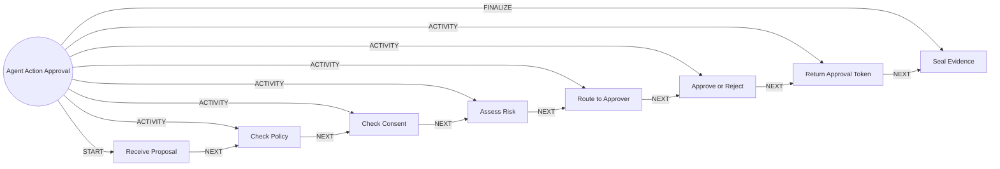

# Agent Action Approval

> The gate every agent uses before a risky action: policy, consent, risk, human approval, then evidence.

## Use this process when
- approve an agent action
- agent wants to
- needs approval
- human in the loop

## Do not use it when
- model change: use [Model Lifecycle](model-lifecycle.md)

## Trigger and ownership
- **Triggered by:** [Agent action proposed](../events.md#evt.agent_action_proposed)
- **Performed by:** [Governance Agent](../actors/agents.md#actor.governance_agent) (autonomy ceiling A1)
- **Escalates to:** [Compliance Officer](../actors/humans-and-external.md#actor.compliance_officer), [Relationship Manager](../actors/humans-and-external.md#actor.relationship_manager)
- **Emits:** none
- **Governed by:** [Agent Guardrails](../policies/agent-guardrails.md), [Approval Matrix](../policies/approval-matrix.md), [Consent and Privacy](../policies/consent-and-privacy.md), [Audit and Evidence](../policies/audit-and-evidence.md)

## Flow
Work the steps in order. At each step, open the linked activity file before acting. A step marked conditional is skipped when its condition is false, and the skip is recorded.

| # | Step | Edge | Activities | Performed by | Approval gate | Autonomy | Condition | What happens |
|---|---|---|---|---|---|---|---|---|
| 1 | **Receive Proposal** | START | inline | [Governance Agent](../actors/agents.md#actor.governance_agent) | none | A3 | always | Receive the proposed action, scope and evidence from the requesting agent. |
| 2 | **Check Policy** | ACTIVITY | inline | [Governance Agent](../actors/agents.md#actor.governance_agent) | none | A1 | always | Check the action against guardrails and the approval matrix. Reject out-of-ontology actions. |
| 3 | **Check Consent** | ACTIVITY | [Check Consent](../activities/check-consent.md) | [Governance Agent](../actors/agents.md#actor.governance_agent) | none | A3 | always | Check the consent the action relies on. |
| 4 | **Assess Risk** | ACTIVITY | inline | [Governance Agent](../actors/agents.md#actor.governance_agent) | none | A1 | always | Assign a risk tier to the action and select the approver role. |
| 5 | **Route to Approver** | ACTIVITY | [Route to Approver](../activities/route-to-approver.md) | [Governance Agent](../actors/agents.md#actor.governance_agent) | none | A2 | always | Send the package to the approver. |
| 6 | **Approve or Reject** | ACTIVITY | inline | [Governance Agent](../actors/agents.md#actor.governance_agent) | [Relationship Manager](../actors/humans-and-external.md#actor.relationship_manager) (always) | A2 | always | The approver in the matrix decides. Self-approval is not possible. |
| 7 | **Return Approval Token** | ACTIVITY | inline | [Governance Agent](../actors/agents.md#actor.governance_agent) | none | A3 | always | Return a scoped, expiring approval token to the requesting agent. The governance agent does not execute. |
| 8 | **Seal Evidence** | FINALIZE | inline | [Governance Agent](../actors/agents.md#actor.governance_agent) | none | A3 | always | Seal the decision, reasons and token into the audit trail. |

## Graph edges
`proc.agent_action_approval` is the hub. Edges follow the hub-and-spoke pattern: the hub STARTs the first step, has an ACTIVITY edge to each middle step, FINALIZEs the last, and steps chain with NEXT.

## Exceptions
| If | Then |
|---|---|
| Approver equals requester | Reject routing. Choose another approver. |
| Approval expires | The agent must propose again. |

## Finalize (done means)
A scoped decision exists in the audit trail, and the requesting agent holds a token or a rejection.

## Data touched
| Object | Access | Backing tables |
|---|---|---|
| [Approval Request](../objects/governance-and-data.md#obj.approval_request) | reads and writes | `service_requests`, `approval_actions`, `banking_workflows` |
| [Consent](../objects/customer.md#obj.consent) | reads | `consents`, `bank_preferences` |
| [Policy Rule](../objects/governance-and-data.md#obj.policy_rule) | reads | `bank_sentinel_decisions`, `audit_events` |
| [Audit Event](../objects/governance-and-data.md#obj.audit_event) | writes | `audit_events`, `bank_audit_log` |

## Evidence emitted
Event types from the activities above (see [Audit and Evidence](../policies/audit-and-evidence.md)): `consent.checked`, `approval.requested`, `approval.approved`, `approval.rejected`, `approval.expired`.

## Related
- Related processes: [Model Lifecycle](model-lifecycle.md)
- Routing and event map: [routing.md](../routing.md)
