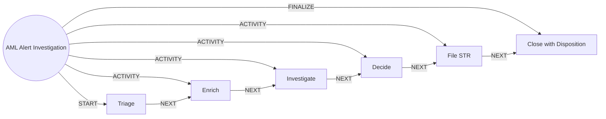

# AML Alert Investigation

> Triages, enriches and investigates AML alerts. Agents prepare, humans decide and file.

## Use this process when
- AML alert
- suspicious transaction
- STR
- SAR
- structuring
- sanctions alert

## Do not use it when
- fraud reported by the customer: use [Fraud and Dispute](fraud-and-dispute.md)
- periodic KYC refresh: use [Perpetual KYC](perpetual-kyc.md)

## Trigger and ownership
- **Triggered by:** [AML alert raised](../events.md#evt.aml_alert_raised)
- **Performed by:** [AML Triage Agent](../actors/agents.md#actor.aml_agent) (autonomy ceiling A1)
- **Escalates to:** [AML Investigator](../actors/humans-and-external.md#actor.aml_investigator), [Money Laundering Reporting Officer](../actors/humans-and-external.md#actor.mlro)
- **Emits:** none
- **Governed by:** [Agent Guardrails](../policies/agent-guardrails.md), [Approval Matrix](../policies/approval-matrix.md), [Audit and Evidence](../policies/audit-and-evidence.md)

## Flow
Work the steps in order. At each step, open the linked activity file before acting. A step marked conditional is skipped when its condition is false, and the skip is recorded.

| # | Step | Edge | Activities | Performed by | Approval gate | Autonomy | Condition | What happens |
|---|---|---|---|---|---|---|---|---|
| 1 | **Triage** | START | inline | [AML Triage Agent](../actors/agents.md#actor.aml_agent) | none | A1 | always | De-duplicate and prioritise by severity and customer risk. |
| 2 | **Enrich** | ACTIVITY | [Build Customer Context](../activities/build-customer-context.md) | [AML Triage Agent](../actors/agents.md#actor.aml_agent) | none | A1 | always | Add household links, counterparties and recent activity to the alert. |
| 3 | **Investigate** | ACTIVITY | inline | [AML Triage Agent](../actors/agents.md#actor.aml_agent) | none | A1 | always | Draft an investigation narrative with evidence. Draft only. |
| 4 | **Decide** | ACTIVITY | [Route to Approver](../activities/route-to-approver.md) | [AML Triage Agent](../actors/agents.md#actor.aml_agent) | [AML Investigator](../actors/humans-and-external.md#actor.aml_investigator) (always) | A2 | always | Investigator decides: false positive, escalate or suspicious. |
| 5 | **File STR** | ACTIVITY | [Route to Approver](../activities/route-to-approver.md) | [AML Triage Agent](../actors/agents.md#actor.aml_agent) | [Money Laundering Reporting Officer](../actors/humans-and-external.md#actor.mlro) (always) | A2 | Only if suspicious. | MLRO decides and files. The agent prepares the report. |
| 6 | **Close with Disposition** | FINALIZE | inline | [AML Triage Agent](../actors/agents.md#actor.aml_agent) | none | A3 | always | Record disposition and reason. |

## Graph edges
`proc.aml_alert_investigation` is the hub. Edges follow the hub-and-spoke pattern: the hub STARTs the first step, has an ACTIVITY edge to each middle step, FINALIZEs the last, and steps chain with NEXT.

## Exceptions
| If | Then |
|---|---|
| Customer asks about the alert | Do not confirm or deny. Hand over to compliance. |
| Alert linked to a confirmed sanctions match | Escalate to the MLRO immediately. |

## Finalize (done means)
Alert dispositioned by a human with evidence, and STR filed where required.

## Data touched
| Object | Access | Backing tables |
|---|---|---|
| [Alert](../objects/service-and-risk.md#obj.alert) | reads and writes | `core_aml_alerts`, `bank_security_alerts` |
| [Customer](../objects/customer.md#obj.customer) | reads | `bank_customers`, `core_customer_contacts`, `bank_preferences`, `app_users` |
| [Household](../objects/customer.md#obj.household) | reads | `crm_relationships` |
| [Transaction](../objects/accounts-payments.md#obj.transaction) | reads | `bank_transactions` |

## Evidence emitted
Event types from the activities above (see [Audit and Evidence](../policies/audit-and-evidence.md)): `context.built`, `approval.requested`, `approval.approved`, `approval.rejected`, `approval.expired`.

## Related
- Related processes: [Fraud and Dispute](fraud-and-dispute.md), [Perpetual KYC](perpetual-kyc.md)
- Routing and event map: [routing.md](../routing.md)
