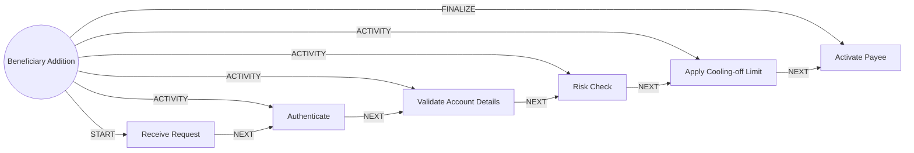

# Beneficiary Addition

> Adds or edits a payee with validation and a cooling-off limit, since new payees are a common fraud vector.

## Use this process when
- add a payee
- add beneficiary
- new recipient
- save a payee
- new payee

## Do not use it when
- pay an existing payee: use [Payment Authorisation](payment-authorisation.md)

## Trigger and ownership
- **Triggered by:** [Beneficiary add requested](../events.md#evt.beneficiary_add_requested)
- **Performed by:** [Payments and Cards Agent](../actors/agents.md#actor.payments_agent) (autonomy ceiling A3)
- **Escalates to:** [Fraud Analyst](../actors/humans-and-external.md#actor.fraud_analyst)
- **Emits:** none
- **Governed by:** [Authentication Assurance](../policies/authentication-assurance.md), [Agent Guardrails](../policies/agent-guardrails.md), [Audit and Evidence](../policies/audit-and-evidence.md)

## Flow
Work the steps in order. At each step, open the linked activity file before acting. A step marked conditional is skipped when its condition is false, and the skip is recorded.

| # | Step | Edge | Activities | Performed by | Approval gate | Autonomy | Condition | What happens |
|---|---|---|---|---|---|---|---|---|
| 1 | **Receive Request** | START | inline | [Payments and Cards Agent](../actors/agents.md#actor.payments_agent) | none | A3 | always | Capture the payee details. |
| 2 | **Authenticate** | ACTIVITY | [Authenticate (Step-Up)](../activities/authenticate-step-up.md) | [Payments and Cards Agent](../actors/agents.md#actor.payments_agent) | none | A3 | always | Step-up before the payee is stored. |
| 3 | **Validate Account Details** | ACTIVITY | [Validate Beneficiary](../activities/validate-beneficiary.md) | [Payments and Cards Agent](../actors/agents.md#actor.payments_agent) | none | A3 | always | Validate details and check name match. |
| 4 | **Risk Check** | ACTIVITY | [Score Transaction Risk](../activities/score-transaction-risk.md) | [Payments and Cards Agent](../actors/agents.md#actor.payments_agent) | none | A3 | always | Score payee risk with device and session context. |
| 5 | **Apply Cooling-off Limit** | ACTIVITY | inline | [Payments and Cards Agent](../actors/agents.md#actor.payments_agent) | none | A3 | always | Apply a reduced limit to the new payee for the configured period. |
| 6 | **Activate Payee** | FINALIZE | [Notify Customer](../activities/notify-customer.md) | [Payments and Cards Agent](../actors/agents.md#actor.payments_agent) | none | A3 | always | Activate and notify the customer. |

## Graph edges
`proc.beneficiary_addition` is the hub. Edges follow the hub-and-spoke pattern: the hub STARTs the first step, has an ACTIVITY edge to each middle step, FINALIZEs the last, and steps chain with NEXT.

## Exceptions
| If | Then |
|---|---|
| Name mismatch | Show the mismatch and require explicit confirmation. |
| Mule or sanctions indicator | Restrict the payee and send to the fraud analyst. |

## Finalize (done means)
Payee active with cooling-off limit, or rejected with reason.

## Data touched
| Object | Access | Backing tables |
|---|---|---|
| [Customer](../objects/customer.md#obj.customer) | reads | `bank_customers`, `core_customer_contacts`, `bank_preferences`, `app_users` |
| [Beneficiary](../objects/accounts-payments.md#obj.beneficiary) | reads and writes | `bank_beneficiaries` |

## Evidence emitted
Event types from the activities above (see [Audit and Evidence](../policies/audit-and-evidence.md)): `auth.step_up_passed`, `auth.step_up_failed`, `auth.step_up_locked`, `beneficiary.validated`, `beneficiary.restricted`, `payment.risk_decision`, `notify.sent`, `notify.failed`.

## Related
- Related processes: [Payment Authorisation](payment-authorisation.md)
- Routing and event map: [routing.md](../routing.md)
