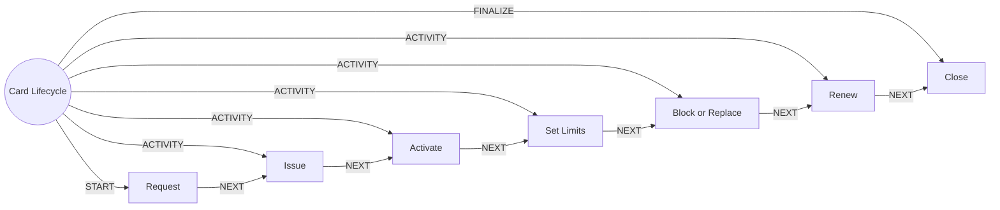

# Card Lifecycle

> Issues, activates, limits, blocks, replaces and closes cards.

## Use this process when
- new card
- replace card
- block card
- card limit
- activate card
- lost card

## Do not use it when
- fraud on the card: use [Fraud and Dispute](fraud-and-dispute.md)

## Trigger and ownership
- **Triggered by:** [Card requested](../events.md#evt.card_requested)
- **Performed by:** [Payments and Cards Agent](../actors/agents.md#actor.payments_agent) (autonomy ceiling A3)
- **Escalates to:** [Service Officer](../actors/humans-and-external.md#actor.service_officer), [Fraud Analyst](../actors/humans-and-external.md#actor.fraud_analyst)
- **Emits:** none
- **Governed by:** [Authentication Assurance](../policies/authentication-assurance.md), [Agent Guardrails](../policies/agent-guardrails.md), [Audit and Evidence](../policies/audit-and-evidence.md)

## Flow
Work the steps in order. At each step, open the linked activity file before acting. A step marked conditional is skipped when its condition is false, and the skip is recorded.

| # | Step | Edge | Activities | Performed by | Approval gate | Autonomy | Condition | What happens |
|---|---|---|---|---|---|---|---|---|
| 1 | **Request** | START | [Authenticate (Step-Up)](../activities/authenticate-step-up.md) | [Payments and Cards Agent](../actors/agents.md#actor.payments_agent) | none | A3 | always | Capture request type: new, replacement, limit change or block. |
| 2 | **Issue** | ACTIVITY | inline | [Payments and Cards Agent](../actors/agents.md#actor.payments_agent) | none | A3 | always | Create the card record and send to production. |
| 3 | **Activate** | ACTIVITY | [Authenticate (Step-Up)](../activities/authenticate-step-up.md) | [Payments and Cards Agent](../actors/agents.md#actor.payments_agent) | none | A3 | always | Customer activates with step-up. Card is unusable before activation. |
| 4 | **Set Limits** | ACTIVITY | [Check Limits and Balance](../activities/check-limits-and-balance.md) | [Payments and Cards Agent](../actors/agents.md#actor.payments_agent) | none | A3 | always | Apply channel limits. Customers may lower freely. Raising requires step-up. |
| 5 | **Block or Replace** | ACTIVITY | inline | [Payments and Cards Agent](../actors/agents.md#actor.payments_agent) | none | A3 | always | Immediate block on loss or theft (no approval). Replacement issues a new card number. |
| 6 | **Renew** | ACTIVITY | inline | [Payments and Cards Agent](../actors/agents.md#actor.payments_agent) | none | A3 | always | Reissue before expiry and retire the old card. |
| 7 | **Close** | FINALIZE | [Notify Customer](../activities/notify-customer.md) | [Payments and Cards Agent](../actors/agents.md#actor.payments_agent) | none | A3 | always | Close the card and cancel linked tokens and mandates. |

## Graph edges
`proc.card_lifecycle` is the hub. Edges follow the hub-and-spoke pattern: the hub STARTs the first step, has an ACTIVITY edge to each middle step, FINALIZEs the last, and steps chain with NEXT.

## Exceptions
| If | Then |
|---|---|
| Reported lost or stolen | Block immediately, then proceed to replacement. |
| Delivery address changed recently | Hold dispatch and verify with the customer. |

## Finalize (done means)
Card in the requested state with limits applied and the customer informed.

## Data touched
| Object | Access | Backing tables |
|---|---|---|
| [Card](../objects/accounts-payments.md#obj.card) | reads and writes | `bank_cards`, `ret_card_authorizations`, `ret_transaction_limits` |
| [Account](../objects/accounts-payments.md#obj.account) | reads | `bank_accounts`, `core_account_holders`, `gl_account_balances`, `ret_nominees` |
| [Customer](../objects/customer.md#obj.customer) | reads | `bank_customers`, `core_customer_contacts`, `bank_preferences`, `app_users` |

## Evidence emitted
Event types from the activities above (see [Audit and Evidence](../policies/audit-and-evidence.md)): `auth.step_up_passed`, `auth.step_up_failed`, `auth.step_up_locked`, `payment.limits_checked`, `notify.sent`, `notify.failed`.

## Related
- Related processes: [Fraud and Dispute](fraud-and-dispute.md)
- Routing and event map: [routing.md](../routing.md)
