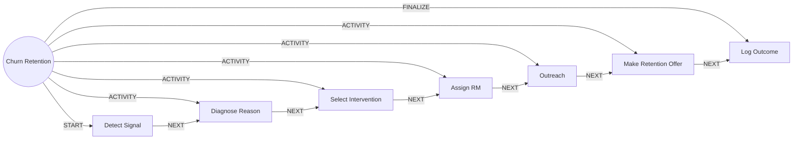

# Churn Retention

> Detects churn risk early, diagnoses it and coordinates the right intervention.

## Use this process when
- customer might leave
- churn risk
- retention
- closing intent
- win back

## Do not use it when
- customer already asked to close the account: use [Dormancy and Closure](dormancy-and-closure.md)
- general complaint: use [Service Case (Control Tower)](service-case.md)

## Trigger and ownership
- **Triggered by:** [Churn signal](../events.md#evt.churn_signal)
- **Performed by:** [Retention Agent](../actors/agents.md#actor.retention_agent) (autonomy ceiling A2)
- **Escalates to:** [Relationship Manager](../actors/humans-and-external.md#actor.relationship_manager)
- **Emits:** none
- **Governed by:** [Consent and Privacy](../policies/consent-and-privacy.md), [Approval Matrix](../policies/approval-matrix.md), [Audit and Evidence](../policies/audit-and-evidence.md)

## Flow
Work the steps in order. At each step, open the linked activity file before acting. A step marked conditional is skipped when its condition is false, and the skip is recorded.

| # | Step | Edge | Activities | Performed by | Approval gate | Autonomy | Condition | What happens |
|---|---|---|---|---|---|---|---|---|
| 1 | **Detect Signal** | START | inline | [Retention Agent](../actors/agents.md#actor.retention_agent) | none | A3 | always | Receive a churn score above threshold or an event such as balance drain, closure intent or repeated complaints. |
| 2 | **Diagnose Reason** | ACTIVITY | [Build Customer Context](../activities/build-customer-context.md) | [Retention Agent](../actors/agents.md#actor.retention_agent) | none | A3 | always | Classify the likely reason: price, service failure, life event or competitor. |
| 3 | **Select Intervention** | ACTIVITY | inline | [Retention Agent](../actors/agents.md#actor.retention_agent) | none | A3 | always | Choose service fix, fee waiver, retention offer or personal call. |
| 4 | **Assign RM** | ACTIVITY | [Route to Approver](../activities/route-to-approver.md) | [Retention Agent](../actors/agents.md#actor.retention_agent) | [Relationship Manager](../actors/humans-and-external.md#actor.relationship_manager) (always) | A2 | always | Create a task and assign the relationship manager for high-value or sensitive customers. |
| 5 | **Outreach** | ACTIVITY | [Check Consent](../activities/check-consent.md), [Notify Customer](../activities/notify-customer.md) | [Retention Agent](../actors/agents.md#actor.retention_agent) | none | A3 | always | Reach out by the allowed channel. |
| 6 | **Make Retention Offer** | ACTIVITY | [Check Eligibility and Suitability](../activities/check-eligibility-suitability.md) | [Retention Agent](../actors/agents.md#actor.retention_agent) | [Relationship Manager](../actors/humans-and-external.md#actor.relationship_manager) (only when the concession exceeds agent authority) | A3; A2 when gated | always | Present the approved offer. |
| 7 | **Log Outcome** | FINALIZE | [Write Back Outcome](../activities/write-back-outcome.md) | [Retention Agent](../actors/agents.md#actor.retention_agent) | none | A3 | always | Store the outcome and reason and update churn labels. |

## Graph edges
`proc.churn_retention` is the hub. Edges follow the hub-and-spoke pattern: the hub STARTs the first step, has an ACTIVITY edge to each middle step, FINALIZEs the last, and steps chain with NEXT.

## Exceptions
| If | Then |
|---|---|
| Root cause is an unresolved service issue | Open a case first, then continue retention. |
| Concession exceeds agent authority | Relationship manager approves, adjusts or rejects. |

## Finalize (done means)
Intervention made or consciously skipped, outcome stored, risk label updated.

## Data touched
| Object | Access | Backing tables |
|---|---|---|
| [Customer](../objects/customer.md#obj.customer) | reads | `bank_customers`, `core_customer_contacts`, `bank_preferences`, `app_users` |
| [Interaction](../objects/engagement.md#obj.interaction) | reads and writes | `crm_interactions`, `conversation_sessions`, `mitra_turns`, `chat_feedback` |
| [Case](../objects/service-and-risk.md#obj.case) | reads | `care_cases`, `crm_case_comments` |
| [Lead and Opportunity](../objects/engagement.md#obj.lead_opportunity) | writes | `cross_sell_leads`, `crm_opportunities` |

## Evidence emitted
Event types from the activities above (see [Audit and Evidence](../policies/audit-and-evidence.md)): `context.built`, `approval.requested`, `approval.approved`, `approval.rejected`, `approval.expired`, `consent.checked`, `notify.sent`, `notify.failed`, `product.eligibility_checked`, `outcome.recorded`.

## Related
- Related processes: [Dormancy and Closure](dormancy-and-closure.md), [Service Case (Control Tower)](service-case.md)
- Routing and event map: [routing.md](../routing.md)
