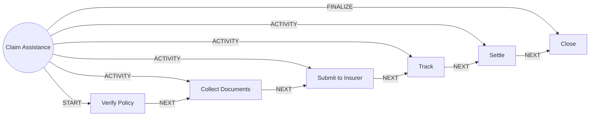

# Claim Assistance

> Helps a customer file and track an insurance claim. The insurer adjudicates, the bank assists.

## Use this process when
- file a claim
- insurance claim
- claim status
- hospitalisation claim
- death claim

## Do not use it when
- buy insurance: use [Insurance Sale](insurance-sale.md)

## Trigger and ownership
- **Triggered by:** [Claim intimated](../events.md#evt.claim_intimated)
- **Performed by:** [Insurance Agent](../actors/agents.md#actor.insurance_agent) (autonomy ceiling A2)
- **Escalates to:** [Service Officer](../actors/humans-and-external.md#actor.service_officer), [Licensed Insurance Advisor](../actors/humans-and-external.md#actor.licensed_advisor)
- **Emits:** none
- **Governed by:** [Consent and Privacy](../policies/consent-and-privacy.md), [Agent Guardrails](../policies/agent-guardrails.md), [Audit and Evidence](../policies/audit-and-evidence.md)

## Flow
Work the steps in order. At each step, open the linked activity file before acting. A step marked conditional is skipped when its condition is false, and the skip is recorded.

| # | Step | Edge | Activities | Performed by | Approval gate | Autonomy | Condition | What happens |
|---|---|---|---|---|---|---|---|---|
| 1 | **Verify Policy** | START | [Verify Identity](../activities/verify-identity.md) | [Insurance Agent](../actors/agents.md#actor.insurance_agent) | none | A3 | always | Confirm the policy is in force and the claimant is entitled. |
| 2 | **Collect Documents** | ACTIVITY | [Collect Documents](../activities/collect-documents.md) | [Insurance Agent](../actors/agents.md#actor.insurance_agent) | none | A3 | always | Collect claim documents against the insurer's checklist. |
| 3 | **Submit to Insurer** | ACTIVITY | inline | [Insurance Agent](../actors/agents.md#actor.insurance_agent) | none | A3 | always | Submit the claim package and record the insurer reference. |
| 4 | **Track** | ACTIVITY | [Open Case](../activities/open-case.md) | [Insurance Agent](../actors/agents.md#actor.insurance_agent) | none | A3 | always | Track status and keep the customer informed. |
| 5 | **Settle** | ACTIVITY | [Post to Ledger](../activities/post-to-ledger.md) | [Partner Insurer](../actors/humans-and-external.md#actor.insurer) | none | A3 | always | The insurer decides and pays. Reconcile the payout. |
| 6 | **Close** | FINALIZE | [Notify Customer](../activities/notify-customer.md) | [Insurance Agent](../actors/agents.md#actor.insurance_agent) | none | A3 | always | Close the claim and record feedback. |

## Graph edges
`proc.claim_assistance` is the hub. Edges follow the hub-and-spoke pattern: the hub STARTs the first step, has an ACTIVITY edge to each middle step, FINALIZEs the last, and steps chain with NEXT.

## Exceptions
| If | Then |
|---|---|
| Death claim or bereaved claimant | Hand over to a service officer for a human, compassionate process. |
| Insurer rejects the claim | Explain the reason and the appeal path. Do not argue the decision. |

## Finalize (done means)
Claim submitted and tracked to settlement or closure with the customer informed.

## Data touched
| Object | Access | Backing tables |
|---|---|---|
| [Insurance Policy](../objects/insurance.md#obj.insurance_policy) | reads | `ins_policies`, `ins_proposals`, `ins_coverages`, `ins_insured_persons`, `ins_policy_nominees`, `ins_endorsements`, `ins_policy_events` |
| [Claim](../objects/insurance.md#obj.claim) | reads and writes | `ins_claims`, `ins_claim_documents` |
| [Customer](../objects/customer.md#obj.customer) | reads | `bank_customers`, `core_customer_contacts`, `bank_preferences`, `app_users` |
| [Document](../objects/customer.md#obj.document) | writes | `documents`, `los_application_documents`, `ins_claim_documents`, `ret_statements` |
| [Case](../objects/service-and-risk.md#obj.case) | writes | `care_cases`, `crm_case_comments` |

## Evidence emitted
Event types from the activities above (see [Audit and Evidence](../policies/audit-and-evidence.md)): `kyc.identity_verified`, `kyc.identity_failed`, `kyc.identity_manual_review`, `doc.received`, `doc.verified`, `doc.rejected`, `doc.tamper_flag`, `case.opened`, `ledger.entry_posted`, `ledger.entry_reversed`, `notify.sent`, `notify.failed`.

## Related
- Related processes: [Insurance Sale](insurance-sale.md)
- Routing and event map: [routing.md](../routing.md)
