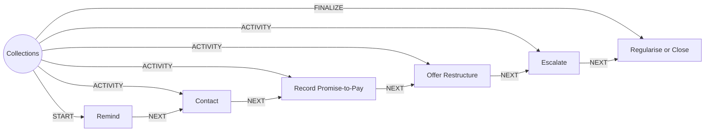

# Collections

> Handles missed instalments with early, respectful contact and a path back to regular payment.

## Use this process when
- missed EMI
- overdue loan
- collections
- promise to pay
- restructure a loan

## Do not use it when
- loan application: use [Loan Origination](loan-origination.md)

## Trigger and ownership
- **Triggered by:** [EMI missed](../events.md#evt.emi_missed), [Loan disbursed](../events.md#evt.loan_disbursed)
- **Performed by:** [Collections Agent](../actors/agents.md#actor.collections_agent) (autonomy ceiling A2)
- **Escalates to:** [Collections Officer](../actors/humans-and-external.md#actor.collections_officer)
- **Emits:** none
- **Governed by:** [Agent Guardrails](../policies/agent-guardrails.md), [Consent and Privacy](../policies/consent-and-privacy.md), [Approval Matrix](../policies/approval-matrix.md), [Audit and Evidence](../policies/audit-and-evidence.md)

## Flow
Work the steps in order. At each step, open the linked activity file before acting. A step marked conditional is skipped when its condition is false, and the skip is recorded.

| # | Step | Edge | Activities | Performed by | Approval gate | Autonomy | Condition | What happens |
|---|---|---|---|---|---|---|---|---|
| 1 | **Remind** | START | [Notify Customer](../activities/notify-customer.md) | [Collections Agent](../actors/agents.md#actor.collections_agent) | none | A3 | always | Send a friendly reminder within permitted contact hours. |
| 2 | **Contact** | ACTIVITY | [Check Consent](../activities/check-consent.md), [Open Case](../activities/open-case.md) | [Collections Agent](../actors/agents.md#actor.collections_agent) | none | A3 | always | Attempt contact and log each attempt. Disclose that the agent is an AI. |
| 3 | **Record Promise-to-Pay** | ACTIVITY | inline | [Collections Agent](../actors/agents.md#actor.collections_agent) | none | A3 | always | Record promise date and amount. |
| 4 | **Offer Restructure** | ACTIVITY | [Route to Approver](../activities/route-to-approver.md) | [Collections Agent](../actors/agents.md#actor.collections_agent) | [Collections Officer](../actors/humans-and-external.md#actor.collections_officer) (always) | A2 | always | Offer a restructure within policy. Approval required. |
| 5 | **Escalate** | ACTIVITY | [Route to Approver](../activities/route-to-approver.md) | [Collections Agent](../actors/agents.md#actor.collections_agent) | [Collections Officer](../actors/humans-and-external.md#actor.collections_officer) (always) | A2 | Only if no response after the configured attempts. | Escalate to legal or field recovery with the contact log. |
| 6 | **Regularise or Close** | FINALIZE | [Write Back Outcome](../activities/write-back-outcome.md) | [Collections Agent](../actors/agents.md#actor.collections_agent) | none | A3 | always | Record repayment, restructure, legal or write-off outcome. |

## Graph edges
`proc.collections` is the hub. Edges follow the hub-and-spoke pattern: the hub STARTs the first step, has an ACTIVITY edge to each middle step, FINALIZEs the last, and steps chain with NEXT.

## Exceptions
| If | Then |
|---|---|
| Customer states hardship or vulnerability | Stop sales or pressure language. Hand over to a human. |
| Customer disputes the debt | Open a case and pause collection until reviewed. |
| Outside permitted hours or frequency | Do not contact. |

## Finalize (done means)
Arrears cleared, restructured or escalated with a full contact log.

## Data touched
| Object | Access | Backing tables |
|---|---|---|
| [Loan](../objects/lending.md#obj.loan) | reads and writes | `los_sanctions`, `los_loan_accounts`, `los_disbursements` |
| [Repayment](../objects/lending.md#obj.repayment) | reads | `los_repayment_schedules`, `los_repayments` |
| [Customer](../objects/customer.md#obj.customer) | reads | `bank_customers`, `core_customer_contacts`, `bank_preferences`, `app_users` |
| [Consent](../objects/customer.md#obj.consent) | reads | `consents`, `bank_preferences` |
| [Collections Case](../objects/lending.md#obj.collections_case) | writes | `los_collections_cases` |
| [Interaction](../objects/engagement.md#obj.interaction) | writes | `crm_interactions`, `conversation_sessions`, `mitra_turns`, `chat_feedback` |

## Evidence emitted
Event types from the activities above (see [Audit and Evidence](../policies/audit-and-evidence.md)): `notify.sent`, `notify.failed`, `consent.checked`, `case.opened`, `approval.requested`, `approval.approved`, `approval.rejected`, `approval.expired`, `outcome.recorded`.

## Related
- Related processes: [Loan Origination](loan-origination.md)
- Routing and event map: [routing.md](../routing.md)
