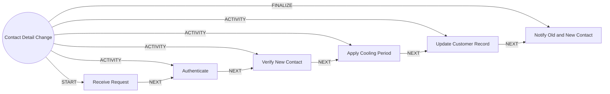

# Contact Detail Change

> Changes phone, email or address safely, because this is a common first step of account takeover.

## Use this process when
- change phone number
- change email
- update address
- update mobile

## Do not use it when
- suspected takeover: use [Fraud and Dispute](fraud-and-dispute.md)

## Trigger and ownership
- **Triggered by:** [Contact change requested](../events.md#evt.contact_change_requested)
- **Performed by:** [Service Agent](../actors/agents.md#actor.service_agent) (autonomy ceiling A3)
- **Escalates to:** [Service Officer](../actors/humans-and-external.md#actor.service_officer), [Fraud Analyst](../actors/humans-and-external.md#actor.fraud_analyst)
- **Emits:** none
- **Governed by:** [Authentication Assurance](../policies/authentication-assurance.md), [Agent Guardrails](../policies/agent-guardrails.md), [Audit and Evidence](../policies/audit-and-evidence.md)

## Flow
Work the steps in order. At each step, open the linked activity file before acting. A step marked conditional is skipped when its condition is false, and the skip is recorded.

| # | Step | Edge | Activities | Performed by | Approval gate | Autonomy | Condition | What happens |
|---|---|---|---|---|---|---|---|---|
| 1 | **Receive Request** | START | inline | [Service Agent](../actors/agents.md#actor.service_agent) | none | A3 | always | Capture the requested change and the channel it came in on. |
| 2 | **Authenticate** | ACTIVITY | [Authenticate (Step-Up)](../activities/authenticate-step-up.md) | [Service Agent](../actors/agents.md#actor.service_agent) | none | A3 | always | Require step-up at the level in the authentication policy. |
| 3 | **Verify New Contact** | ACTIVITY | inline | [Service Agent](../actors/agents.md#actor.service_agent) | none | A3 | always | Send a one-time code to the new contact and confirm possession. |
| 4 | **Apply Cooling Period** | ACTIVITY | inline | [Service Agent](../actors/agents.md#actor.service_agent) | none | A3 | always | Restrict high-risk actions (new payees, limit increases) for the configured period. |
| 5 | **Update Customer Record** | ACTIVITY | inline | [Service Agent](../actors/agents.md#actor.service_agent) | none | A3 | always | Write the new contact point with validity dates. |
| 6 | **Notify Old and New Contact** | FINALIZE | [Notify Customer](../activities/notify-customer.md) | [Service Agent](../actors/agents.md#actor.service_agent) | none | A3 | always | Notify both the old and the new contact. Do not skip the old one. |

## Graph edges
`proc.contact_detail_change` is the hub. Edges follow the hub-and-spoke pattern: the hub STARTs the first step, has an ACTIVITY edge to each middle step, FINALIZEs the last, and steps chain with NEXT.

## Exceptions
| If | Then |
|---|---|
| Step-up fails | Block the change and flag possible takeover to the fraud analyst. |
| Change requested right after failed logins or a new device | Raise assurance requirement and alert fraud. |

## Finalize (done means)
Contact updated, both contacts notified, cooling period applied.

## Data touched
| Object | Access | Backing tables |
|---|---|---|
| [Customer](../objects/customer.md#obj.customer) | reads and writes | `bank_customers`, `core_customer_contacts`, `bank_preferences`, `app_users` |

## Evidence emitted
Event types from the activities above (see [Audit and Evidence](../policies/audit-and-evidence.md)): `auth.step_up_passed`, `auth.step_up_failed`, `auth.step_up_locked`, `notify.sent`, `notify.failed`.

## Related
- Related processes: [Fraud and Dispute](fraud-and-dispute.md)
- Routing and event map: [routing.md](../routing.md)
