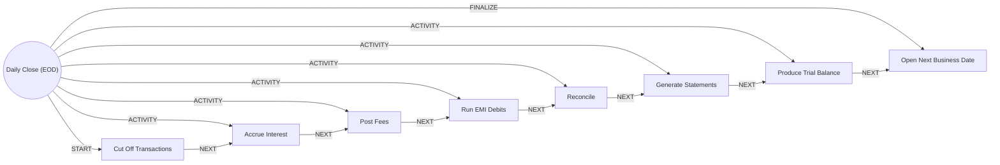

# Daily Close (EOD)

> Closes the business date: accruals, fees, EMI debits, reconciliation, statements and trial balance.

## Use this process when
- end of day
- EOD
- day close
- trial balance
- accrual run
- business date roll

## Do not use it when
- regulatory report: use [Regulatory Reporting](regulatory-reporting.md)

## Trigger and ownership
- **Triggered by:** [Business date end](../events.md#evt.business_date_end)
- **Performed by:** [Operations Agent](../actors/agents.md#actor.operations_agent) (autonomy ceiling A3)
- **Escalates to:** [Operations Officer](../actors/humans-and-external.md#actor.operations_officer), [Finance Operations](../actors/humans-and-external.md#actor.finance_ops)
- **Emits:** none
- **Governed by:** [Audit and Evidence](../policies/audit-and-evidence.md), [Agent Guardrails](../policies/agent-guardrails.md)

## Flow
Work the steps in order. At each step, open the linked activity file before acting. A step marked conditional is skipped when its condition is false, and the skip is recorded.

| # | Step | Edge | Activities | Performed by | Approval gate | Autonomy | Condition | What happens |
|---|---|---|---|---|---|---|---|---|
| 1 | **Cut Off Transactions** | START | inline | [Operations Agent](../actors/agents.md#actor.operations_agent) | none | A3 | always | Stop accepting new postings for the date. |
| 2 | **Accrue Interest** | ACTIVITY | [Post to Ledger](../activities/post-to-ledger.md) | [Batch / Posting Engine](../actors/humans-and-external.md#actor.system_batch) | none | A3 | always | Accrue deposit and loan interest. |
| 3 | **Post Fees** | ACTIVITY | [Post to Ledger](../activities/post-to-ledger.md) | [Batch / Posting Engine](../actors/humans-and-external.md#actor.system_batch) | none | A3 | always | Post due fees and charges. |
| 4 | **Run EMI Debits** | ACTIVITY | [Post to Ledger](../activities/post-to-ledger.md) | [Batch / Posting Engine](../actors/humans-and-external.md#actor.system_batch) | none | A3 | always | Run standing instructions and loan EMI debits. |
| 5 | **Reconcile** | ACTIVITY | [Reconcile](../activities/reconcile.md) | [Operations Agent](../actors/agents.md#actor.operations_agent) | [Finance Operations](../actors/humans-and-external.md#actor.finance_ops) (only when breaks exceed tolerance) | A3 | always | Reconcile ledger to sub-ledgers and external statements. Breaks go to finance operations. |
| 6 | **Generate Statements** | ACTIVITY | inline | [Operations Agent](../actors/agents.md#actor.operations_agent) | none | A3 | always | Generate statements for the cycle. |
| 7 | **Produce Trial Balance** | ACTIVITY | inline | [Operations Agent](../actors/agents.md#actor.operations_agent) | none | A3 | always | Produce the trial balance and balance snapshots. |
| 8 | **Open Next Business Date** | FINALIZE | inline | [Operations Agent](../actors/agents.md#actor.operations_agent) | none | A3 | always | Roll the business date when all prior steps succeed. |

## Graph edges
`proc.daily_close_eod` is the hub. Edges follow the hub-and-spoke pattern: the hub STARTs the first step, has an ACTIVITY edge to each middle step, FINALIZEs the last, and steps chain with NEXT.

## Exceptions
| If | Then |
|---|---|
| A job fails | Halt the date roll. Operations officer fixes and re-runs. The agent may re-run idempotent jobs only. |
| Reconciliation break above tolerance | Hold the date roll until finance operations signs off. |

## Finalize (done means)
Business date rolled with a balanced trial balance and complete audit evidence.

## Data touched
| Object | Access | Backing tables |
|---|---|---|
| [Account](../objects/accounts-payments.md#obj.account) | reads and writes | `bank_accounts`, `core_account_holders`, `gl_account_balances`, `ret_nominees` |
| [Journal Entry](../objects/accounts-payments.md#obj.journal_entry) | reads and writes | `gl_journal_entries`, `gl_journal_lines`, `gl_posting_rules`, `gl_chart_of_accounts` |
| [Repayment](../objects/lending.md#obj.repayment) | reads | `los_repayment_schedules`, `los_repayments` |
| [Standing Instruction](../objects/accounts-payments.md#obj.standing_instruction) | reads | `ret_standing_instructions` |
| [Transaction](../objects/accounts-payments.md#obj.transaction) | writes | `bank_transactions` |

## Evidence emitted
Event types from the activities above (see [Audit and Evidence](../policies/audit-and-evidence.md)): `ledger.entry_posted`, `ledger.entry_reversed`, `recon.completed`, `recon.break_found`.

## Related
- Related processes: [Regulatory Reporting](regulatory-reporting.md)
- Routing and event map: [routing.md](../routing.md)
