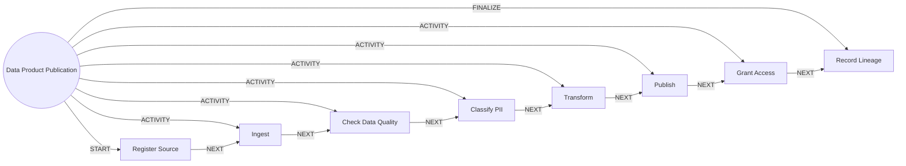

# Data Product Publication

> Brings a new source into the lake and publishes a governed, quality-checked dataset.

## Use this process when
- new data source
- publish a dataset
- onboard data
- ingest
- data pipeline

## Do not use it when
- regulatory report: use [Regulatory Reporting](regulatory-reporting.md)

## Trigger and ownership
- **Triggered by:** [New data source](../events.md#evt.new_data_source)
- **Performed by:** [Data Agent](../actors/agents.md#actor.data_agent) (autonomy ceiling A2)
- **Escalates to:** [Data Steward](../actors/humans-and-external.md#actor.data_steward)
- **Emits:** none
- **Governed by:** [Consent and Privacy](../policies/consent-and-privacy.md), [Audit and Evidence](../policies/audit-and-evidence.md), [Approval Matrix](../policies/approval-matrix.md)

## Flow
Work the steps in order. At each step, open the linked activity file before acting. A step marked conditional is skipped when its condition is false, and the skip is recorded.

| # | Step | Edge | Activities | Performed by | Approval gate | Autonomy | Condition | What happens |
|---|---|---|---|---|---|---|---|---|
| 1 | **Register Source** | START | inline | [Data Agent](../actors/agents.md#actor.data_agent) | none | A3 | always | Register the source, owner, refresh mode and whether it holds personal data. |
| 2 | **Ingest** | ACTIVITY | inline | [Data Agent](../actors/agents.md#actor.data_agent) | none | A3 | always | Ingest to the raw zone with run tracking. |
| 3 | **Check Data Quality** | ACTIVITY | [Check Data Quality](../activities/check-data-quality.md) | [Data Agent](../actors/agents.md#actor.data_agent) | none | A3 | always | Run quality rules and block on critical failure. |
| 4 | **Classify PII** | ACTIVITY | inline | [Data Agent](../actors/agents.md#actor.data_agent) | none | A3 | always | Classify columns, tag sensitivity and set masking rules. |
| 5 | **Transform** | ACTIVITY | inline | [Data Agent](../actors/agents.md#actor.data_agent) | none | A3 | always | Build curated and mart layers with lineage. |
| 6 | **Publish** | ACTIVITY | inline | [Data Agent](../actors/agents.md#actor.data_agent) | none | A3 | always | Publish the dataset to the catalogue. |
| 7 | **Grant Access** | ACTIVITY | [Route to Approver](../activities/route-to-approver.md) | [Data Agent](../actors/agents.md#actor.data_agent) | [Data Steward](../actors/humans-and-external.md#actor.data_steward) (always) | A2 | always | Steward approves access grants by purpose and masking. |
| 8 | **Record Lineage** | FINALIZE | inline | [Data Agent](../actors/agents.md#actor.data_agent) | none | A3 | always | Store upstream and downstream lineage. |

## Graph edges
`proc.data_product_publication` is the hub. Edges follow the hub-and-spoke pattern: the hub STARTs the first step, has an ACTIVITY edge to each middle step, FINALIZEs the last, and steps chain with NEXT.

## Exceptions
| If | Then |
|---|---|
| PII found in an unclassified column | Block publish until classified. |
| Source schema changes | Pause ingest, notify the steward. |

## Finalize (done means)
Dataset published with classification, quality results, access grants and lineage.

## Data touched
| Object | Access | Backing tables |
|---|---|---|
| [Dataset](../objects/governance-and-data.md#obj.dataset) | reads and writes | `dl_datasets`, `dl_dataset_columns`, `dl_lineage_edges`, `dl_dq_rules`, `dl_dq_results`, `dl_access_grants` |

## Evidence emitted
Event types from the activities above (see [Audit and Evidence](../policies/audit-and-evidence.md)): `dq.evaluated`, `approval.requested`, `approval.approved`, `approval.rejected`, `approval.expired`.

## Related
- Related processes: [Regulatory Reporting](regulatory-reporting.md)
- Routing and event map: [routing.md](../routing.md)
