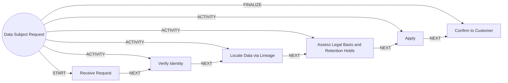

# Data Subject Request

> Handles a customer's request to access, correct or delete their personal data.

## Use this process when
- delete my data
- access my data
- right to erasure
- data export
- correct my data
- privacy request

## Do not use it when
- contact detail change: use [Contact Detail Change](contact-detail-change.md)

## Trigger and ownership
- **Triggered by:** [Data subject request received](../events.md#evt.dsr_received)
- **Performed by:** [Data Agent](../actors/agents.md#actor.data_agent) (autonomy ceiling A2)
- **Escalates to:** [Privacy Officer](../actors/humans-and-external.md#actor.privacy_officer)
- **Emits:** none
- **Governed by:** [Consent and Privacy](../policies/consent-and-privacy.md), [Agent Guardrails](../policies/agent-guardrails.md), [Audit and Evidence](../policies/audit-and-evidence.md)

## Flow
Work the steps in order. At each step, open the linked activity file before acting. A step marked conditional is skipped when its condition is false, and the skip is recorded.

| # | Step | Edge | Activities | Performed by | Approval gate | Autonomy | Condition | What happens |
|---|---|---|---|---|---|---|---|---|
| 1 | **Receive Request** | START | inline | [Data Agent](../actors/agents.md#actor.data_agent) | none | A3 | always | Capture the request type and scope. |
| 2 | **Verify Identity** | ACTIVITY | [Verify Identity](../activities/verify-identity.md) | [Data Agent](../actors/agents.md#actor.data_agent) | none | A3 | always | Verify the requester. |
| 3 | **Locate Data via Lineage** | ACTIVITY | inline | [Data Agent](../actors/agents.md#actor.data_agent) | none | A3 | always | Find the customer's data across datasets using lineage and classification. |
| 4 | **Assess Legal Basis and Retention Holds** | ACTIVITY | [Route to Approver](../activities/route-to-approver.md) | [Data Agent](../actors/agents.md#actor.data_agent) | [Privacy Officer](../actors/humans-and-external.md#actor.privacy_officer) (always) | A2 | always | Decide what must be kept for regulatory reasons and what can be deleted. |
| 5 | **Apply** | ACTIVITY | inline | [Data Agent](../actors/agents.md#actor.data_agent) | none | A3 | always | Export, correct, mask or delete as decided. |
| 6 | **Confirm to Customer** | FINALIZE | [Notify Customer](../activities/notify-customer.md) | [Data Agent](../actors/agents.md#actor.data_agent) | none | A3 | always | Confirm what was done and what was retained and why. |

## Graph edges
`proc.data_subject_request` is the hub. Edges follow the hub-and-spoke pattern: the hub STARTs the first step, has an ACTIVITY edge to each middle step, FINALIZEs the last, and steps chain with NEXT.

## Exceptions
| If | Then |
|---|---|
| Records under legal or regulatory retention | Retain, restrict processing and explain. |
| Request is part of an investigation | Do not disclose investigation data. Hand over to compliance. |

## Finalize (done means)
Request completed within its deadline with a record of what was kept and why.

## Data touched
| Object | Access | Backing tables |
|---|---|---|
| [Dataset](../objects/governance-and-data.md#obj.dataset) | reads and writes | `dl_datasets`, `dl_dataset_columns`, `dl_lineage_edges`, `dl_dq_rules`, `dl_dq_results`, `dl_access_grants` |
| [Customer](../objects/customer.md#obj.customer) | reads | `bank_customers`, `core_customer_contacts`, `bank_preferences`, `app_users` |
| [Consent](../objects/customer.md#obj.consent) | reads | `consents`, `bank_preferences` |
| [Data Subject Request](../objects/governance-and-data.md#obj.data_subject_request) | writes | `(none yet - add dl or privacy table)` |

## Evidence emitted
Event types from the activities above (see [Audit and Evidence](../policies/audit-and-evidence.md)): `kyc.identity_verified`, `kyc.identity_failed`, `kyc.identity_manual_review`, `approval.requested`, `approval.approved`, `approval.rejected`, `approval.expired`, `notify.sent`, `notify.failed`.

## Related
- Related processes: [Contact Detail Change](contact-detail-change.md)
- Routing and event map: [routing.md](../routing.md)
