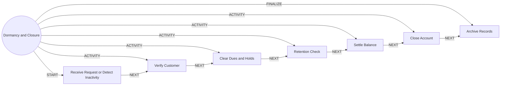

# Dormancy and Closure

> Handles inactive accounts and closes accounts cleanly, with a retention check.

## Use this process when
- close my account
- dormant account
- inactive account
- reactivate account
- account closure

## Do not use it when
- customer is unhappy but not closing: use [Churn Retention](churn-retention.md)

## Trigger and ownership
- **Triggered by:** [Inactivity threshold reached](../events.md#evt.inactivity_threshold), [Closure requested](../events.md#evt.closure_requested)
- **Performed by:** [Service Agent](../actors/agents.md#actor.service_agent) (autonomy ceiling A3)
- **Escalates to:** [Service Officer](../actors/humans-and-external.md#actor.service_officer), [Compliance Officer](../actors/humans-and-external.md#actor.compliance_officer)
- **Emits:** none
- **Governed by:** [Authentication Assurance](../policies/authentication-assurance.md), [Agent Guardrails](../policies/agent-guardrails.md), [Audit and Evidence](../policies/audit-and-evidence.md)

## Flow
Work the steps in order. At each step, open the linked activity file before acting. A step marked conditional is skipped when its condition is false, and the skip is recorded.

| # | Step | Edge | Activities | Performed by | Approval gate | Autonomy | Condition | What happens |
|---|---|---|---|---|---|---|---|---|
| 1 | **Receive Request or Detect Inactivity** | START | inline | [Service Agent](../actors/agents.md#actor.service_agent) | none | A3 | always | Capture the closure request or the inactivity detection. |
| 2 | **Verify Customer** | ACTIVITY | [Authenticate (Step-Up)](../activities/authenticate-step-up.md), [Verify Identity](../activities/verify-identity.md) | [Service Agent](../actors/agents.md#actor.service_agent) | none | A3 | always | Step-up. Verify identity for dormant reactivation or closure with a large balance. |
| 3 | **Clear Dues and Holds** | ACTIVITY | [Check Limits and Balance](../activities/check-limits-and-balance.md) | [Service Agent](../actors/agents.md#actor.service_agent) | none | A3 | always | Confirm no loans, holds, standing instructions or pending cheques block closure. |
| 4 | **Retention Check** | ACTIVITY | inline | [Service Agent](../actors/agents.md#actor.service_agent) | none | A3 | Only if the customer asked to close. | Offer a handover to Churn Retention. The customer may decline. |
| 5 | **Settle Balance** | ACTIVITY | [Post to Ledger](../activities/post-to-ledger.md) | [Service Agent](../actors/agents.md#actor.service_agent) | none | A3 | always | Pay the balance to a verified account. |
| 6 | **Close Account** | ACTIVITY | inline | [Service Agent](../actors/agents.md#actor.service_agent) | none | A3 | always | Set the account closed. Stop cards, standing instructions and alerts. |
| 7 | **Archive Records** | FINALIZE | [Notify Customer](../activities/notify-customer.md) | [Service Agent](../actors/agents.md#actor.service_agent) | none | A3 | always | Archive per retention rules and send the closure confirmation. |

## Graph edges
`proc.dormancy_and_closure` is the hub. Edges follow the hub-and-spoke pattern: the hub STARTs the first step, has an ACTIVITY edge to each middle step, FINALIZEs the last, and steps chain with NEXT.

## Exceptions
| If | Then |
|---|---|
| Legal hold or investigation | Do not close. Escalate to compliance. No tipping off. |
| Large balance on dormant account | Service officer reviews. |

## Finalize (done means)
Account closed or reactivated, balance settled, records archived.

## Data touched
| Object | Access | Backing tables |
|---|---|---|
| [Account](../objects/accounts-payments.md#obj.account) | reads and writes | `bank_accounts`, `core_account_holders`, `gl_account_balances`, `ret_nominees` |
| [Customer](../objects/customer.md#obj.customer) | reads | `bank_customers`, `core_customer_contacts`, `bank_preferences`, `app_users` |
| [Standing Instruction](../objects/accounts-payments.md#obj.standing_instruction) | reads and writes | `ret_standing_instructions` |
| [Card](../objects/accounts-payments.md#obj.card) | writes | `bank_cards`, `ret_card_authorizations`, `ret_transaction_limits` |
| [Transaction](../objects/accounts-payments.md#obj.transaction) | writes | `bank_transactions` |

## Evidence emitted
Event types from the activities above (see [Audit and Evidence](../policies/audit-and-evidence.md)): `auth.step_up_passed`, `auth.step_up_failed`, `auth.step_up_locked`, `kyc.identity_verified`, `kyc.identity_failed`, `kyc.identity_manual_review`, `payment.limits_checked`, `ledger.entry_posted`, `ledger.entry_reversed`, `notify.sent`, `notify.failed`.

## Related
- Related processes: [Churn Retention](churn-retention.md)
- Routing and event map: [routing.md](../routing.md)
