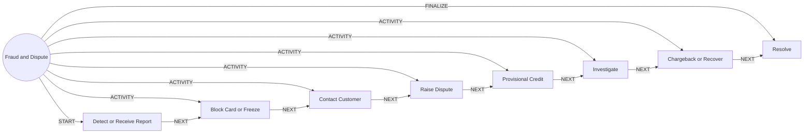

# Fraud and Dispute

> Protects the customer first, then investigates and resolves a disputed or fraudulent transaction.

## Use this process when
- unauthorised transaction
- I did not make this payment
- fraud
- card stolen
- chargeback
- dispute a transaction

## Do not use it when
- wrong beneficiary typed by customer: use [Service Case (Control Tower)](service-case.md)

## Trigger and ownership
- **Triggered by:** [Suspicious activity](../events.md#evt.suspicious_activity)
- **Performed by:** [Fraud Triage Agent](../actors/agents.md#actor.fraud_agent) (autonomy ceiling A3)
- **Escalates to:** [Fraud Analyst](../actors/humans-and-external.md#actor.fraud_analyst)
- **Emits:** none
- **Governed by:** [Agent Guardrails](../policies/agent-guardrails.md), [Approval Matrix](../policies/approval-matrix.md), [Audit and Evidence](../policies/audit-and-evidence.md)

## Flow
Work the steps in order. At each step, open the linked activity file before acting. A step marked conditional is skipped when its condition is false, and the skip is recorded.

| # | Step | Edge | Activities | Performed by | Approval gate | Autonomy | Condition | What happens |
|---|---|---|---|---|---|---|---|---|
| 1 | **Detect or Receive Report** | START | inline | [Fraud Triage Agent](../actors/agents.md#actor.fraud_agent) | none | A3 | always | Receive a fraud signal or customer report and identify affected accounts and cards. |
| 2 | **Block Card or Freeze** | ACTIVITY | inline | [Fraud Triage Agent](../actors/agents.md#actor.fraud_agent) | none | A3 | always | Protective block applied immediately. Reversible. |
| 3 | **Contact Customer** | ACTIVITY | [Authenticate (Step-Up)](../activities/authenticate-step-up.md), [Notify Customer](../activities/notify-customer.md) | [Fraud Triage Agent](../actors/agents.md#actor.fraud_agent) | none | A3 | always | Reach the customer through a verified channel and confirm what happened. |
| 4 | **Raise Dispute** | ACTIVITY | [Open Case](../activities/open-case.md) | [Fraud Triage Agent](../actors/agents.md#actor.fraud_agent) | none | A3 | always | Create the dispute and linked case with the turnaround deadline. |
| 5 | **Provisional Credit** | ACTIVITY | [Post to Ledger](../activities/post-to-ledger.md) | [Fraud Triage Agent](../actors/agents.md#actor.fraud_agent) | [Fraud Analyst](../actors/humans-and-external.md#actor.fraud_analyst) (always) | A2 | Where policy requires a provisional credit. | Credit the amount provisionally, posted via the ledger. |
| 6 | **Investigate** | ACTIVITY | inline | [Fraud Triage Agent](../actors/agents.md#actor.fraud_agent) | [Fraud Analyst](../actors/humans-and-external.md#actor.fraud_analyst) (always) | A1 | always | Analyst reviews evidence. The agent assembles it but does not decide. |
| 7 | **Chargeback or Recover** | ACTIVITY | inline | [Fraud Triage Agent](../actors/agents.md#actor.fraud_agent) | none | A3 | always | File network chargeback or recovery according to the decision. |
| 8 | **Resolve** | FINALIZE | [Notify Customer](../activities/notify-customer.md) | [Fraud Triage Agent](../actors/agents.md#actor.fraud_agent) | none | A3 | always | Close the dispute, reverse or confirm the provisional credit and notify. |

## Graph edges
`proc.fraud_and_dispute` is the hub. Edges follow the hub-and-spoke pattern: the hub STARTs the first step, has an ACTIVITY edge to each middle step, FINALIZEs the last, and steps chain with NEXT.

## Exceptions
| If | Then |
|---|---|
| Customer cannot be reached | Keep the protective block. Retry per policy. Escalate to the analyst. |
| Customer was the beneficiary of a scam (authorised push payment) | Route to the analyst and apply the scam-reimbursement policy. |
| Dispute deadline near | Escalate to the analyst automatically. |

## Finalize (done means)
Customer protected, dispute decided within the deadline and ledger consistent.

## Data touched
| Object | Access | Backing tables |
|---|---|---|
| [Transaction](../objects/accounts-payments.md#obj.transaction) | reads | `bank_transactions` |
| [Card](../objects/accounts-payments.md#obj.card) | reads and writes | `bank_cards`, `ret_card_authorizations`, `ret_transaction_limits` |
| [Account](../objects/accounts-payments.md#obj.account) | reads | `bank_accounts`, `core_account_holders`, `gl_account_balances`, `ret_nominees` |
| [Customer](../objects/customer.md#obj.customer) | reads | `bank_customers`, `core_customer_contacts`, `bank_preferences`, `app_users` |
| [Dispute](../objects/service-and-risk.md#obj.dispute) | writes | `ret_disputes` |
| [Case](../objects/service-and-risk.md#obj.case) | writes | `care_cases`, `crm_case_comments` |
| [Journal Entry](../objects/accounts-payments.md#obj.journal_entry) | writes | `gl_journal_entries`, `gl_journal_lines`, `gl_posting_rules`, `gl_chart_of_accounts` |
| [Alert](../objects/service-and-risk.md#obj.alert) | writes | `core_aml_alerts`, `bank_security_alerts` |

## Evidence emitted
Event types from the activities above (see [Audit and Evidence](../policies/audit-and-evidence.md)): `auth.step_up_passed`, `auth.step_up_failed`, `auth.step_up_locked`, `notify.sent`, `notify.failed`, `case.opened`, `ledger.entry_posted`, `ledger.entry_reversed`.

## Related
- Related processes: [Service Case (Control Tower)](service-case.md)
- Routing and event map: [routing.md](../routing.md)
