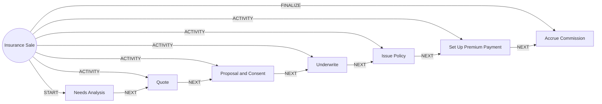

# Insurance Sale

> Sells partner insurance with a needs analysis, suitability check and the customer's consent to share data.

## Use this process when
- buy insurance
- term life
- health insurance
- insurance quote
- bancassurance
- policy purchase

## Do not use it when
- claim on an existing policy: use [Claim Assistance](claim-assistance.md)
- generic offer: use [Next Best Offer](next-best-offer.md)

## Trigger and ownership
- **Triggered by:** [Insurance lead](../events.md#evt.insurance_lead)
- **Performed by:** [Insurance Agent](../actors/agents.md#actor.insurance_agent) (autonomy ceiling A2)
- **Escalates to:** [Licensed Insurance Advisor](../actors/humans-and-external.md#actor.licensed_advisor), [Relationship Manager](../actors/humans-and-external.md#actor.relationship_manager)
- **Emits:** none
- **Governed by:** [Consent and Privacy](../policies/consent-and-privacy.md), [Agent Guardrails](../policies/agent-guardrails.md), [Approval Matrix](../policies/approval-matrix.md), [Audit and Evidence](../policies/audit-and-evidence.md)

## Flow
Work the steps in order. At each step, open the linked activity file before acting. A step marked conditional is skipped when its condition is false, and the skip is recorded.

| # | Step | Edge | Activities | Performed by | Approval gate | Autonomy | Condition | What happens |
|---|---|---|---|---|---|---|---|---|
| 1 | **Needs Analysis** | START | [Build Customer Context](../activities/build-customer-context.md), [Check Eligibility and Suitability](../activities/check-eligibility-suitability.md) | [Insurance Agent](../actors/agents.md#actor.insurance_agent) | [Licensed Insurance Advisor](../actors/humans-and-external.md#actor.licensed_advisor) (only when regulation requires advice or the customer is vulnerable) | A3; A2 when gated | always | Understand need and capacity and check suitability. |
| 2 | **Quote** | ACTIVITY | inline | [Insurance Agent](../actors/agents.md#actor.insurance_agent) | none | A3 | always | Get a premium quote from the insurer. |
| 3 | **Proposal and Consent** | ACTIVITY | [Check Consent](../activities/check-consent.md), [Collect Documents](../activities/collect-documents.md) | [Insurance Agent](../actors/agents.md#actor.insurance_agent) | none | A3 | always | Capture declarations and consent to share data with the insurer. |
| 4 | **Underwrite** | ACTIVITY | inline | [Partner Insurer](../actors/humans-and-external.md#actor.insurer) | none | A3 | always | Insurer underwrites. The agent relays the decision and never overrides it. |
| 5 | **Issue Policy** | ACTIVITY | inline | [Insurance Agent](../actors/agents.md#actor.insurance_agent) | none | A3 | always | Record the issued policy, insured persons and nominees. |
| 6 | **Set Up Premium Payment** | ACTIVITY | [Authenticate (Step-Up)](../activities/authenticate-step-up.md) | [Insurance Agent](../actors/agents.md#actor.insurance_agent) | none | A3 | always | Create the premium mandate or standing instruction. |
| 7 | **Accrue Commission** | FINALIZE | inline | [Insurance Agent](../actors/agents.md#actor.insurance_agent) | none | A3 | always | Record bancassurance commission and emit the policy event. |

## Graph edges
`proc.insurance_sale` is the hub. Edges follow the hub-and-spoke pattern: the hub STARTs the first step, has an ACTIVITY edge to each middle step, FINALIZEs the last, and steps chain with NEXT.

## Exceptions
| If | Then |
|---|---|
| Customer is vulnerable or buying a complex product | Licensed advisor must take over. |
| Insurer declines | Relay the decision and options. Do not push other products automatically. |
| Loan applicant is nudged to buy cover | Not allowed. Insurance is never made a condition of credit unless the product rules say so. |

## Finalize (done means)
Policy issued with consent and nominee on record, premium arranged and commission accrued.

## Data touched
| Object | Access | Backing tables |
|---|---|---|
| [Customer](../objects/customer.md#obj.customer) | reads | `bank_customers`, `core_customer_contacts`, `bank_preferences`, `app_users` |
| [Product](../objects/engagement.md#obj.product) | reads | `core_products`, `core_interest_rates`, `core_fee_schedules`, `los_loan_products`, `ins_products` |
| [Insurer](../objects/insurance.md#obj.insurer) | reads | `ins_insurers`, `ins_products`, `ins_commissions` |
| [Consent](../objects/customer.md#obj.consent) | reads | `consents`, `bank_preferences` |
| [Insurance Quote](../objects/insurance.md#obj.insurance_quote) | writes | `ins_quotes`, `ins_products` |
| [Insurance Policy](../objects/insurance.md#obj.insurance_policy) | writes | `ins_policies`, `ins_proposals`, `ins_coverages`, `ins_insured_persons`, `ins_policy_nominees`, `ins_endorsements`, `ins_policy_events` |
| [Premium](../objects/insurance.md#obj.premium) | writes | `ins_premium_schedule`, `ins_premium_payments` |
| [Standing Instruction](../objects/accounts-payments.md#obj.standing_instruction) | writes | `ret_standing_instructions` |

## Evidence emitted
Event types from the activities above (see [Audit and Evidence](../policies/audit-and-evidence.md)): `context.built`, `product.eligibility_checked`, `consent.checked`, `doc.received`, `doc.verified`, `doc.rejected`, `doc.tamper_flag`, `auth.step_up_passed`, `auth.step_up_failed`, `auth.step_up_locked`.

## Related
- Related processes: [Claim Assistance](claim-assistance.md), [Next Best Offer](next-best-offer.md)
- Routing and event map: [routing.md](../routing.md)
