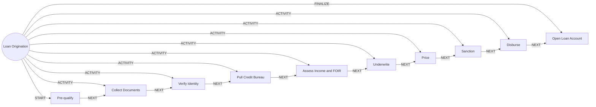

# Loan Origination

> Takes a loan from pre-qualification through underwriting, sanction and disbursement.

## Use this process when
- apply for a loan
- apply for a personal loan
- apply for a home loan
- loan eligibility
- sanction
- disburse

## Do not use it when
- customer is behind on payments: use [Collections](collections.md)
- overdraft on a new account: use [Account Opening](account-opening.md)

## Trigger and ownership
- **Triggered by:** [Loan requested](../events.md#evt.loan_requested)
- **Performed by:** [Lending Agent](../actors/agents.md#actor.lending_agent) (autonomy ceiling A2)
- **Escalates to:** [Credit Officer](../actors/humans-and-external.md#actor.credit_officer)
- **Emits:** [Loan disbursed](../events.md#evt.loan_disbursed)
- **Governed by:** [Consent and Privacy](../policies/consent-and-privacy.md), [Agent Guardrails](../policies/agent-guardrails.md), [Approval Matrix](../policies/approval-matrix.md), [Audit and Evidence](../policies/audit-and-evidence.md)

## Flow
Work the steps in order. At each step, open the linked activity file before acting. A step marked conditional is skipped when its condition is false, and the skip is recorded.

| # | Step | Edge | Activities | Performed by | Approval gate | Autonomy | Condition | What happens |
|---|---|---|---|---|---|---|---|---|
| 1 | **Pre-qualify** | START | [Check Eligibility and Suitability](../activities/check-eligibility-suitability.md), [Check Consent](../activities/check-consent.md) | [Lending Agent](../actors/agents.md#actor.lending_agent) | none | A3 | always | Indicative eligibility and affordability using declared data. Capture consent for bureau pull. |
| 2 | **Collect Documents** | ACTIVITY | [Collect Documents](../activities/collect-documents.md) | [Lending Agent](../actors/agents.md#actor.lending_agent) | none | A3 | always | Collect income, identity, address and collateral documents. |
| 3 | **Verify Identity** | ACTIVITY | [Verify Identity](../activities/verify-identity.md) | [Lending Agent](../actors/agents.md#actor.lending_agent) | none | A3 | always | Verify applicant and co-applicants. |
| 4 | **Pull Credit Bureau** | ACTIVITY | [Pull Credit Bureau](../activities/pull-credit-bureau.md) | [Lending Agent](../actors/agents.md#actor.lending_agent) | none | A3 | always | Pull bureau data for each applicant. |
| 5 | **Assess Income and FOIR** | ACTIVITY | inline | [Lending Agent](../actors/agents.md#actor.lending_agent) | none | A3 | always | Compute verified income, obligations and fixed-obligation-to-income ratio. |
| 6 | **Underwrite** | ACTIVITY | [Route to Approver](../activities/route-to-approver.md) | [Lending Agent](../actors/agents.md#actor.lending_agent) | [Credit Officer](../actors/humans-and-external.md#actor.credit_officer) (always) | A2 | always | Apply the scorecard and policy and record reason codes. A credit officer decides every underwriting outcome (approve, refer, counter-offer, override, decline). |
| 7 | **Price** | ACTIVITY | inline | [Lending Agent](../actors/agents.md#actor.lending_agent) | none | A3 | always | Set rate and fees from the risk grade and product rate card. |
| 8 | **Sanction** | ACTIVITY | [Notify Customer](../activities/notify-customer.md) | [Lending Agent](../actors/agents.md#actor.lending_agent) | none | A3 | always | Issue the sanction letter. The customer accepts by e-sign. |
| 9 | **Disburse** | ACTIVITY | [Post to Ledger](../activities/post-to-ledger.md) | [Lending Agent](../actors/agents.md#actor.lending_agent) | [Credit Officer](../actors/humans-and-external.md#actor.credit_officer) (always) | A2 | always | Release funds after conditions precedent are met. |
| 10 | **Open Loan Account** | FINALIZE | inline | [Lending Agent](../actors/agents.md#actor.lending_agent) | none | A3 | always | Create loan account and repayment schedule, set the auto-debit mandate and emit loan_disbursed. |

## Graph edges
`proc.loan_origination` is the hub. Edges follow the hub-and-spoke pattern: the hub STARTs the first step, has an ACTIVITY edge to each middle step, FINALIZEs the last, and steps chain with NEXT.

## Exceptions
| If | Then |
|---|---|
| Bureau unavailable | Pause the application and notify the credit officer. Never estimate a score. |
| Document tamper flag | Human verifier decides. |
| Decline | Provide reason codes. Customer may ask for review by a human. |
| Sanction expires | Offer to re-price or restart. |

## Finalize (done means)
Loan account active, schedule created, mandate set, evidence complete.

## Data touched
| Object | Access | Backing tables |
|---|---|---|
| [Customer](../objects/customer.md#obj.customer) | reads | `bank_customers`, `core_customer_contacts`, `bank_preferences`, `app_users` |
| [Document](../objects/customer.md#obj.document) | reads | `documents`, `los_application_documents`, `ins_claim_documents`, `ret_statements` |
| [Credit Report](../objects/lending.md#obj.credit_report) | reads and writes | `los_credit_reports` |
| [Product](../objects/engagement.md#obj.product) | reads | `core_products`, `core_interest_rates`, `core_fee_schedules`, `los_loan_products`, `ins_products` |
| [Consent](../objects/customer.md#obj.consent) | reads | `consents`, `bank_preferences` |
| [Loan Application](../objects/lending.md#obj.loan_application) | writes | `los_applications`, `los_applicants`, `los_applicant_obligations`, `los_underwriting_decisions`, `los_application_events`, `los_application_documents` |
| [Collateral](../objects/lending.md#obj.collateral) | writes | `los_collaterals` |
| [Loan](../objects/lending.md#obj.loan) | writes | `los_sanctions`, `los_loan_accounts`, `los_disbursements` |
| [Repayment](../objects/lending.md#obj.repayment) | writes | `los_repayment_schedules`, `los_repayments` |

## Evidence emitted
Event types from the activities above (see [Audit and Evidence](../policies/audit-and-evidence.md)): `product.eligibility_checked`, `consent.checked`, `doc.received`, `doc.verified`, `doc.rejected`, `doc.tamper_flag`, `kyc.identity_verified`, `kyc.identity_failed`, `kyc.identity_manual_review`, `credit.bureau_pulled`, `approval.requested`, `approval.approved`, `approval.rejected`, `approval.expired`, `notify.sent`, `notify.failed`, `ledger.entry_posted`, `ledger.entry_reversed`.

## Related
- Related processes: [Collections](collections.md), [Account Opening](account-opening.md)
- Routing and event map: [routing.md](../routing.md)
