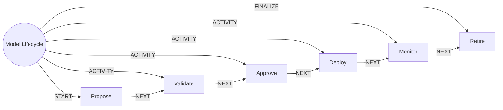

# Model Lifecycle

> Takes a model from proposal through validation, approval, deployment, monitoring and retirement.

## Use this process when
- new model
- model approval
- model drift
- retire a model
- model monitoring

## Do not use it when
- agent action approval: use [Agent Action Approval](agent-action-approval.md)

## Trigger and ownership
- **Triggered by:** [Model change proposed](../events.md#evt.model_change_proposed)
- **Performed by:** [Governance Agent](../actors/agents.md#actor.governance_agent) (autonomy ceiling A1)
- **Escalates to:** [Model Risk Officer](../actors/humans-and-external.md#actor.model_risk_officer)
- **Emits:** none
- **Governed by:** [Approval Matrix](../policies/approval-matrix.md), [Audit and Evidence](../policies/audit-and-evidence.md), [Agent Guardrails](../policies/agent-guardrails.md)

## Flow
Work the steps in order. At each step, open the linked activity file before acting. A step marked conditional is skipped when its condition is false, and the skip is recorded.

| # | Step | Edge | Activities | Performed by | Approval gate | Autonomy | Condition | What happens |
|---|---|---|---|---|---|---|---|---|
| 1 | **Propose** | START | inline | [Governance Agent](../actors/agents.md#actor.governance_agent) | none | A3 | always | Register the model, version, intended use and data. |
| 2 | **Validate** | ACTIVITY | inline | [Governance Agent](../actors/agents.md#actor.governance_agent) | none | A1 | always | Evaluate performance, fairness and robustness. Attach the evaluation summary. |
| 3 | **Approve** | ACTIVITY | [Route to Approver](../activities/route-to-approver.md) | [Governance Agent](../actors/agents.md#actor.governance_agent) | [Model Risk Officer](../actors/humans-and-external.md#actor.model_risk_officer) (always) | A2 | always | Approve with a list of approved use cases. |
| 4 | **Deploy** | ACTIVITY | inline | [Governance Agent](../actors/agents.md#actor.governance_agent) | none | A3 | always | Deploy and mark active in the model registry. |
| 5 | **Monitor** | ACTIVITY | inline | [Governance Agent](../actors/agents.md#actor.governance_agent) | none | A1 | always | Watch drift, performance and fairness. Alert owners on breach. |
| 6 | **Retire** | FINALIZE | inline | [Governance Agent](../actors/agents.md#actor.governance_agent) | none | A3 | always | Retire the model and stop scoring. |

## Graph edges
`proc.model_lifecycle` is the hub. Edges follow the hub-and-spoke pattern: the hub STARTs the first step, has an ACTIVITY edge to each middle step, FINALIZEs the last, and steps chain with NEXT.

## Exceptions
| If | Then |
|---|---|
| Drift or fairness breach | Alert the model risk officer and restrict use to approved fallbacks. |
| Use outside approved use cases | Block the use and report. |

## Finalize (done means)
Model status in the registry matches reality and every change is evidenced.

## Data touched
| Object | Access | Backing tables |
|---|---|---|
| [Model](../objects/governance-and-data.md#obj.model) | reads and writes | `model_registry`, `dl_model_scores` |
| [Dataset](../objects/governance-and-data.md#obj.dataset) | reads | `dl_datasets`, `dl_dataset_columns`, `dl_lineage_edges`, `dl_dq_rules`, `dl_dq_results`, `dl_access_grants` |

## Evidence emitted
Event types from the activities above (see [Audit and Evidence](../policies/audit-and-evidence.md)): `approval.requested`, `approval.approved`, `approval.rejected`, `approval.expired`.

## Related
- Related processes: [Agent Action Approval](agent-action-approval.md)
- Routing and event map: [routing.md](../routing.md)
