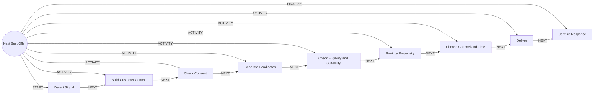

# Next Best Offer

> Chooses the right offer, channel and time for one customer and learns from the response.

## Use this process when
- recommend a product
- next best offer
- cross-sell or up-sell
- welcome offer
- send a personalised offer

## Do not use it when
- customer is leaving: use [Churn Retention](churn-retention.md)
- customer wants a loan now: use [Loan Origination](loan-origination.md)
- customer wants insurance now: use [Insurance Sale](insurance-sale.md)

## Trigger and ownership
- **Triggered by:** [Customer signal](../events.md#evt.customer_signal), [Account opened](../events.md#evt.account_opened)
- **Performed by:** [Marketing Agent](../actors/agents.md#actor.marketing_agent) (autonomy ceiling A3)
- **Escalates to:** [Relationship Manager](../actors/humans-and-external.md#actor.relationship_manager)
- **Emits:** none
- **Governed by:** [Consent and Privacy](../policies/consent-and-privacy.md), [Agent Guardrails](../policies/agent-guardrails.md), [Audit and Evidence](../policies/audit-and-evidence.md)

## Flow
Work the steps in order. At each step, open the linked activity file before acting. A step marked conditional is skipped when its condition is false, and the skip is recorded.

| # | Step | Edge | Activities | Performed by | Approval gate | Autonomy | Condition | What happens |
|---|---|---|---|---|---|---|---|---|
| 1 | **Detect Signal** | START | inline | [Marketing Agent](../actors/agents.md#actor.marketing_agent) | none | A3 | always | Receive the event (salary credit, large balance, life event, new account) and decide whether it is actionable. |
| 2 | **Build Customer Context** | ACTIVITY | [Build Customer Context](../activities/build-customer-context.md) | [Marketing Agent](../actors/agents.md#actor.marketing_agent) | none | A3 | always | Assemble context for the purpose 'offer selection'. |
| 3 | **Check Consent** | ACTIVITY | [Check Consent](../activities/check-consent.md) | [Marketing Agent](../actors/agents.md#actor.marketing_agent) | none | A3 | always | Check marketing consent and channel preferences. Stop if denied. |
| 4 | **Generate Candidates** | ACTIVITY | inline | [Marketing Agent](../actors/agents.md#actor.marketing_agent) | none | A3 | always | List active offers whose segment and eligibility match the customer. |
| 5 | **Check Eligibility and Suitability** | ACTIVITY | [Check Eligibility and Suitability](../activities/check-eligibility-suitability.md) | [Marketing Agent](../actors/agents.md#actor.marketing_agent) | [Relationship Manager](../actors/humans-and-external.md#actor.relationship_manager) (only when the customer is flagged vulnerable) | A3; A2 when gated | always | Remove offers the customer is not eligible for or that are unsuitable. |
| 6 | **Rank by Propensity** | ACTIVITY | inline | [Marketing Agent](../actors/agents.md#actor.marketing_agent) | none | A3 | always | Rank by propensity score and expected value while respecting fatigue limits. |
| 7 | **Choose Channel and Time** | ACTIVITY | inline | [Marketing Agent](../actors/agents.md#actor.marketing_agent) | none | A3 | always | Pick channel and time from preferences, quiet hours and frequency caps. |
| 8 | **Deliver** | ACTIVITY | [Notify Customer](../activities/notify-customer.md) | [Marketing Agent](../actors/agents.md#actor.marketing_agent) | none | A3 | always | Send using an approved template. |
| 9 | **Capture Response** | FINALIZE | [Write Back Outcome](../activities/write-back-outcome.md) | [Marketing Agent](../actors/agents.md#actor.marketing_agent) | none | A3 | always | Record impression, click, accept or decline with reason code. |

## Graph edges
`proc.next_best_offer` is the hub. Edges follow the hub-and-spoke pattern: the hub STARTs the first step, has an ACTIVITY edge to each middle step, FINALIZEs the last, and steps chain with NEXT.

## Exceptions
| If | Then |
|---|---|
| No active marketing consent | Do nothing. Do not infer consent. |
| Customer is flagged vulnerable | Route to the relationship manager. No automated sale. |
| Customer declines | Record the reason and respect the cooling period before the next offer. |

## Finalize (done means)
Offer delivered or consciously withheld, and the response stored.

## Data touched
| Object | Access | Backing tables |
|---|---|---|
| [Customer](../objects/customer.md#obj.customer) | reads | `bank_customers`, `core_customer_contacts`, `bank_preferences`, `app_users` |
| [Segment](../objects/customer.md#obj.segment) | reads | `crm_segments`, `crm_customer_segments` |
| [Offer](../objects/engagement.md#obj.offer) | reads | `crm_offers`, `offer_events` |
| [Product](../objects/engagement.md#obj.product) | reads | `core_products`, `core_interest_rates`, `core_fee_schedules`, `los_loan_products`, `ins_products` |
| [Consent](../objects/customer.md#obj.consent) | reads | `consents`, `bank_preferences` |
| [Interaction](../objects/engagement.md#obj.interaction) | writes | `crm_interactions`, `conversation_sessions`, `mitra_turns`, `chat_feedback` |
| [Lead and Opportunity](../objects/engagement.md#obj.lead_opportunity) | writes | `cross_sell_leads`, `crm_opportunities` |

## Evidence emitted
Event types from the activities above (see [Audit and Evidence](../policies/audit-and-evidence.md)): `context.built`, `consent.checked`, `product.eligibility_checked`, `notify.sent`, `notify.failed`, `outcome.recorded`.

## Related
- Related processes: [Churn Retention](churn-retention.md), [Loan Origination](loan-origination.md), [Insurance Sale](insurance-sale.md)
- Routing and event map: [routing.md](../routing.md)
