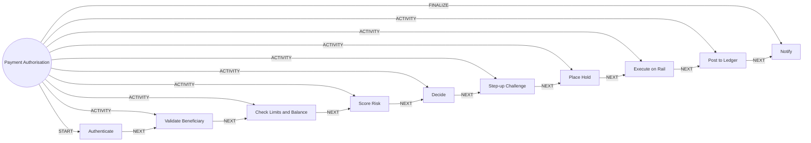

# Payment Authorisation

> Authenticates, validates, risk-scores, holds, sends and posts a payment.

## Use this process when
- send money
- transfer
- pay a bill
- make a payment
- NEFT
- UPI
- IMPS

## Do not use it when
- add a new payee: use [Beneficiary Addition](beneficiary-addition.md)
- unauthorised payment: use [Fraud and Dispute](fraud-and-dispute.md)

## Trigger and ownership
- **Triggered by:** [Payment requested](../events.md#evt.payment_requested)
- **Performed by:** [Payments and Cards Agent](../actors/agents.md#actor.payments_agent) (autonomy ceiling A3)
- **Escalates to:** [Fraud Analyst](../actors/humans-and-external.md#actor.fraud_analyst), [Service Officer](../actors/humans-and-external.md#actor.service_officer)
- **Emits:** none
- **Governed by:** [Authentication Assurance](../policies/authentication-assurance.md), [Approval Matrix](../policies/approval-matrix.md), [Agent Guardrails](../policies/agent-guardrails.md), [Audit and Evidence](../policies/audit-and-evidence.md)

## Flow
Work the steps in order. At each step, open the linked activity file before acting. A step marked conditional is skipped when its condition is false, and the skip is recorded.

| # | Step | Edge | Activities | Performed by | Approval gate | Autonomy | Condition | What happens |
|---|---|---|---|---|---|---|---|---|
| 1 | **Authenticate** | START | [Authenticate (Step-Up)](../activities/authenticate-step-up.md) | [Payments and Cards Agent](../actors/agents.md#actor.payments_agent) | none | A3 | always | Confirm assurance level for the action. |
| 2 | **Validate Beneficiary** | ACTIVITY | [Validate Beneficiary](../activities/validate-beneficiary.md) | [Payments and Cards Agent](../actors/agents.md#actor.payments_agent) | none | A3 | always | Validate payee details and name. |
| 3 | **Check Limits and Balance** | ACTIVITY | [Check Limits and Balance](../activities/check-limits-and-balance.md) | [Payments and Cards Agent](../actors/agents.md#actor.payments_agent) | none | A3 | always | Check funds and limits. |
| 4 | **Score Risk** | ACTIVITY | [Score Transaction Risk](../activities/score-transaction-risk.md) | [Payments and Cards Agent](../actors/agents.md#actor.payments_agent) | none | A3 | always | Get allow, step_up or block with policy version. |
| 5 | **Decide** | ACTIVITY | inline | [Payments and Cards Agent](../actors/agents.md#actor.payments_agent) | none | A3 | always | Apply the decision. Block ends the process with a notification. |
| 6 | **Step-up Challenge** | ACTIVITY | [Authenticate (Step-Up)](../activities/authenticate-step-up.md) | [Payments and Cards Agent](../actors/agents.md#actor.payments_agent) | none | A3 | Only if the decision was step_up. | Challenge the customer. No bypass. |
| 7 | **Place Hold** | ACTIVITY | [Place Balance Hold](../activities/place-balance-hold.md) | [Payments and Cards Agent](../actors/agents.md#actor.payments_agent) | none | A3 | always | Reserve the funds. |
| 8 | **Execute on Rail** | ACTIVITY | inline | [Payments and Cards Agent](../actors/agents.md#actor.payments_agent) | none | A3 | always | Send to the rail (UPI, IMPS, NEFT, RTGS, SWIFT) with an idempotency key. |
| 9 | **Post to Ledger** | ACTIVITY | [Post to Ledger](../activities/post-to-ledger.md) | [Payments and Cards Agent](../actors/agents.md#actor.payments_agent) | none | A3 | always | Post the journal entry and release the hold when settled. |
| 10 | **Notify** | FINALIZE | [Notify Customer](../activities/notify-customer.md) | [Payments and Cards Agent](../actors/agents.md#actor.payments_agent) | none | A3 | always | Notify the customer of the result. |

## Graph edges
`proc.payment_authorisation` is the hub. Edges follow the hub-and-spoke pattern: the hub STARTs the first step, has an ACTIVITY edge to each middle step, FINALIZEs the last, and steps chain with NEXT.

## Exceptions
| If | Then |
|---|---|
| Delegated agent initiates payment | Requires an active delegation and the customer's explicit confirmation in the same session. |
| Rail failure after hold | Release the hold, mark failed, notify. Never leave a hold dangling. |
| Risk model unavailable | Fail safe: step-up or hold for review. |
| Duplicate request | Return the original result through the idempotency key. |

## Finalize (done means)
Payment settled and posted, or cleanly failed with funds released and the customer told.

## Data touched
| Object | Access | Backing tables |
|---|---|---|
| [Account](../objects/accounts-payments.md#obj.account) | reads | `bank_accounts`, `core_account_holders`, `gl_account_balances`, `ret_nominees` |
| [Beneficiary](../objects/accounts-payments.md#obj.beneficiary) | reads | `bank_beneficiaries` |
| [Payment](../objects/accounts-payments.md#obj.payment) | reads and writes | `bank_payment_intents`, `bank_challenges`, `bank_sentinel_decisions`, `core_payment_messages`, `bank_idempotency` |
| [Agent Delegation](../objects/governance-and-data.md#obj.agent_delegation) | reads | `bank_delegations` |
| [Hold](../objects/accounts-payments.md#obj.hold) | writes | `gl_holds` |
| [Transaction](../objects/accounts-payments.md#obj.transaction) | writes | `bank_transactions` |
| [Journal Entry](../objects/accounts-payments.md#obj.journal_entry) | writes | `gl_journal_entries`, `gl_journal_lines`, `gl_posting_rules`, `gl_chart_of_accounts` |

## Evidence emitted
Event types from the activities above (see [Audit and Evidence](../policies/audit-and-evidence.md)): `auth.step_up_passed`, `auth.step_up_failed`, `auth.step_up_locked`, `beneficiary.validated`, `beneficiary.restricted`, `payment.limits_checked`, `payment.risk_decision`, `ledger.hold_placed`, `ledger.hold_released`, `ledger.entry_posted`, `ledger.entry_reversed`, `notify.sent`, `notify.failed`.

## Related
- Related processes: [Beneficiary Addition](beneficiary-addition.md), [Fraud and Dispute](fraud-and-dispute.md)
- Routing and event map: [routing.md](../routing.md)
