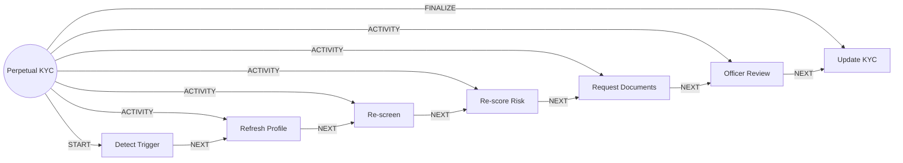

# Perpetual KYC

> Keeps identity, risk and documents current by reacting to events instead of waiting for a calendar review.

## Use this process when
- refresh KYC
- periodic review
- re-verify a customer
- risk rating changed
- adverse media on a customer

## Do not use it when
- new customer onboarding: use [Account Opening](account-opening.md)
- AML alert on a transaction: use [AML Alert Investigation](aml-alert-investigation.md)

## Trigger and ownership
- **Triggered by:** [KYC review due](../events.md#evt.kyc_review_due), [Customer profile changed](../events.md#evt.profile_changed), [Adverse media hit](../events.md#evt.adverse_media_hit)
- **Performed by:** [KYC Agent](../actors/agents.md#actor.kyc_agent) (autonomy ceiling A3)
- **Escalates to:** [Compliance Officer](../actors/humans-and-external.md#actor.compliance_officer)
- **Emits:** none
- **Governed by:** [Consent and Privacy](../policies/consent-and-privacy.md), [Agent Guardrails](../policies/agent-guardrails.md), [Approval Matrix](../policies/approval-matrix.md), [Audit and Evidence](../policies/audit-and-evidence.md)

## Flow
Work the steps in order. At each step, open the linked activity file before acting. A step marked conditional is skipped when its condition is false, and the skip is recorded.

| # | Step | Edge | Activities | Performed by | Approval gate | Autonomy | Condition | What happens |
|---|---|---|---|---|---|---|---|---|
| 1 | **Detect Trigger** | START | [Build Customer Context](../activities/build-customer-context.md) | [KYC Agent](../actors/agents.md#actor.kyc_agent) | none | A3 | always | Load the customer and the trigger reason (scheduled, profile change or adverse media). |
| 2 | **Refresh Profile** | ACTIVITY | inline | [KYC Agent](../actors/agents.md#actor.kyc_agent) | none | A3 | always | Compare declared data with observed behaviour (income vs turnover, address vs activity) and list discrepancies. |
| 3 | **Re-screen** | ACTIVITY | [Screen Sanctions and PEP](../activities/screen-sanctions-pep.md) | [KYC Agent](../actors/agents.md#actor.kyc_agent) | none | A3 | always | Re-screen the customer and related parties. |
| 4 | **Re-score Risk** | ACTIVITY | [Risk-Rate Customer](../activities/risk-rate-customer.md) | [KYC Agent](../actors/agents.md#actor.kyc_agent) | none | A3 | always | Recompute risk rating and compare with the previous rating. |
| 5 | **Request Documents** | ACTIVITY | [Collect Documents](../activities/collect-documents.md) | [KYC Agent](../actors/agents.md#actor.kyc_agent) | none | A3 | Only if risk increased or data is stale or inconsistent. | Ask the customer for updated documents. |
| 6 | **Officer Review** | ACTIVITY | [Route to Approver](../activities/route-to-approver.md) | [KYC Agent](../actors/agents.md#actor.kyc_agent) | [Compliance Officer](../actors/humans-and-external.md#actor.compliance_officer) (always) | A2 | Only if risk increased, a match exists or documents are unresolved. | Compliance officer decides whether to keep, restrict or exit the relationship. |
| 7 | **Update KYC** | FINALIZE | [Notify Customer](../activities/notify-customer.md) | [KYC Agent](../actors/agents.md#actor.kyc_agent) | none | A3 | always | Store the new KYC level, set next_review_due and notify the customer if needed. |

## Graph edges
`proc.perpetual_kyc` is the hub. Edges follow the hub-and-spoke pattern: the hub STARTs the first step, has an ACTIVITY edge to each middle step, FINALIZEs the last, and steps chain with NEXT.

## Exceptions
| If | Then |
|---|---|
| Customer does not respond to document request | Escalate in steps per policy, then restrict the account only on compliance officer approval. |
| Match found during re-screen | Stop automated steps. Compliance officer decides. No tipping off. |
| Rating moves to high | Trigger enhanced due diligence. |

## Finalize (done means)
KYC record updated, next review date set and every change evidenced.

## Data touched
| Object | Access | Backing tables |
|---|---|---|
| [Customer](../objects/customer.md#obj.customer) | reads | `bank_customers`, `core_customer_contacts`, `bank_preferences`, `app_users` |
| [KYC Record](../objects/customer.md#obj.kyc_record) | reads and writes | `core_kyc_records`, `ekyc_sessions` |
| [Risk Factor](../objects/customer.md#obj.risk_factor) | reads and writes | `core_kyc_records`, `core_aml_alerts` |
| [Alert](../objects/service-and-risk.md#obj.alert) | writes | `core_aml_alerts`, `bank_security_alerts` |
| [Document](../objects/customer.md#obj.document) | writes | `documents`, `los_application_documents`, `ins_claim_documents`, `ret_statements` |

## Evidence emitted
Event types from the activities above (see [Audit and Evidence](../policies/audit-and-evidence.md)): `context.built`, `aml.screening_clear`, `aml.screening_potential_match`, `aml.screening_confirmed_match`, `kyc.risk_rated`, `doc.received`, `doc.verified`, `doc.rejected`, `doc.tamper_flag`, `approval.requested`, `approval.approved`, `approval.rejected`, `approval.expired`, `notify.sent`, `notify.failed`.

## Related
- Related processes: [Account Opening](account-opening.md), [AML Alert Investigation](aml-alert-investigation.md)
- Routing and event map: [routing.md](../routing.md)
