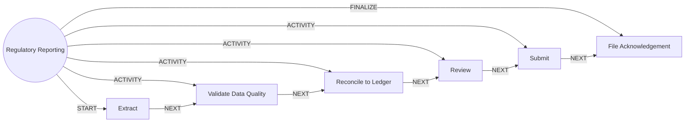

# Regulatory Reporting

> Builds, validates, reconciles and submits periodic regulatory reports with maker-checker control.

## Use this process when
- regulatory report
- regulator submission
- return filing
- report period
- BCBS 239

## Do not use it when
- daily close: use [Daily Close (EOD)](daily-close-eod.md)

## Trigger and ownership
- **Triggered by:** [Reporting period end](../events.md#evt.reporting_period_end)
- **Performed by:** [Reporting Agent](../actors/agents.md#actor.reporting_agent) (autonomy ceiling A2)
- **Escalates to:** [Finance Operations](../actors/humans-and-external.md#actor.finance_ops), [Compliance Officer](../actors/humans-and-external.md#actor.compliance_officer)
- **Emits:** none
- **Governed by:** [Approval Matrix](../policies/approval-matrix.md), [Audit and Evidence](../policies/audit-and-evidence.md), [Agent Guardrails](../policies/agent-guardrails.md)

## Flow
Work the steps in order. At each step, open the linked activity file before acting. A step marked conditional is skipped when its condition is false, and the skip is recorded.

| # | Step | Edge | Activities | Performed by | Approval gate | Autonomy | Condition | What happens |
|---|---|---|---|---|---|---|---|---|
| 1 | **Extract** | START | inline | [Reporting Agent](../actors/agents.md#actor.reporting_agent) | none | A3 | always | Extract data for the report period from governed datasets. |
| 2 | **Validate Data Quality** | ACTIVITY | [Check Data Quality](../activities/check-data-quality.md) | [Reporting Agent](../actors/agents.md#actor.reporting_agent) | none | A3 | always | Run quality rules. Critical failures block the report. |
| 3 | **Reconcile to Ledger** | ACTIVITY | [Reconcile](../activities/reconcile.md) | [Reporting Agent](../actors/agents.md#actor.reporting_agent) | none | A3 | always | Reconcile report totals to the ledger. |
| 4 | **Review** | ACTIVITY | [Route to Approver](../activities/route-to-approver.md) | [Reporting Agent](../actors/agents.md#actor.reporting_agent) | [Finance Operations](../actors/humans-and-external.md#actor.finance_ops) (always) | A2 | always | Finance operations reviews and signs off. |
| 5 | **Submit** | ACTIVITY | [Route to Approver](../activities/route-to-approver.md) | [Reporting Agent](../actors/agents.md#actor.reporting_agent) | [Compliance Officer](../actors/humans-and-external.md#actor.compliance_officer) (always) | A2 | always | Compliance officer approves submission. The agent never submits alone. |
| 6 | **File Acknowledgement** | FINALIZE | inline | [Reporting Agent](../actors/agents.md#actor.reporting_agent) | none | A3 | always | Store the regulator acknowledgement and lineage. |

## Graph edges
`proc.regulatory_reporting` is the hub. Edges follow the hub-and-spoke pattern: the hub STARTs the first step, has an ACTIVITY edge to each middle step, FINALIZEs the last, and steps chain with NEXT.

## Exceptions
| If | Then |
|---|---|
| Critical data-quality failure | Stop and notify the data steward. |
| Reconciliation does not tie | Stop and escalate to finance operations. |
| Regulator rejects the file | Create a correction run, repeat from Validate. |

## Finalize (done means)
Report accepted by the regulator with acknowledgement and lineage stored.

## Data touched
| Object | Access | Backing tables |
|---|---|---|
| [Dataset](../objects/governance-and-data.md#obj.dataset) | reads and writes | `dl_datasets`, `dl_dataset_columns`, `dl_lineage_edges`, `dl_dq_rules`, `dl_dq_results`, `dl_access_grants` |
| [Journal Entry](../objects/accounts-payments.md#obj.journal_entry) | reads | `gl_journal_entries`, `gl_journal_lines`, `gl_posting_rules`, `gl_chart_of_accounts` |
| [Regulatory Report](../objects/governance-and-data.md#obj.regulatory_report) | writes | `dl_regulatory_reports` |

## Evidence emitted
Event types from the activities above (see [Audit and Evidence](../policies/audit-and-evidence.md)): `dq.evaluated`, `recon.completed`, `recon.break_found`, `approval.requested`, `approval.approved`, `approval.rejected`, `approval.expired`.

## Related
- Related processes: [Daily Close (EOD)](daily-close-eod.md)
- Routing and event map: [routing.md](../routing.md)
