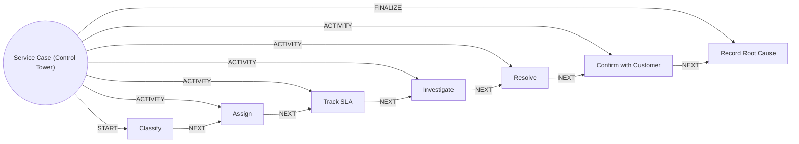

# Service Case (Control Tower)

> Runs a service request or complaint from intake to resolution against its SLA and learns the root cause.

## Use this process when
- customer has a problem
- complaint
- service request
- case status
- SLA breach
- grievance

## Do not use it when
- card or payment fraud: use [Fraud and Dispute](fraud-and-dispute.md)
- change phone or email: use [Contact Detail Change](contact-detail-change.md)
- close account: use [Dormancy and Closure](dormancy-and-closure.md)

## Trigger and ownership
- **Triggered by:** [Case received](../events.md#evt.case_received)
- **Performed by:** [Service Agent](../actors/agents.md#actor.service_agent) (autonomy ceiling A3)
- **Escalates to:** [Service Officer](../actors/humans-and-external.md#actor.service_officer)
- **Emits:** none
- **Governed by:** [Agent Guardrails](../policies/agent-guardrails.md), [Approval Matrix](../policies/approval-matrix.md), [Audit and Evidence](../policies/audit-and-evidence.md)

## Flow
Work the steps in order. At each step, open the linked activity file before acting. A step marked conditional is skipped when its condition is false, and the skip is recorded.

| # | Step | Edge | Activities | Performed by | Approval gate | Autonomy | Condition | What happens |
|---|---|---|---|---|---|---|---|---|
| 1 | **Classify** | START | [Open Case](../activities/open-case.md) | [Service Agent](../actors/agents.md#actor.service_agent) | none | A3 | always | Create the case, classify it and set priority and SLA due date. |
| 2 | **Assign** | ACTIVITY | inline | [Service Agent](../actors/agents.md#actor.service_agent) | none | A3 | always | Assign to the right owner (agent or human) by category and skill. |
| 3 | **Track SLA** | ACTIVITY | inline | [Service Agent](../actors/agents.md#actor.service_agent) | none | A3 | always | Watch deadline and escalate before breach. |
| 4 | **Investigate** | ACTIVITY | [Build Customer Context](../activities/build-customer-context.md) | [Service Agent](../actors/agents.md#actor.service_agent) | none | A3 | always | Gather facts from accounts, transactions and prior cases. |
| 5 | **Resolve** | ACTIVITY | inline | [Service Agent](../actors/agents.md#actor.service_agent) | none | A3 | always | Apply the fix within authority or route to the officer. |
| 6 | **Confirm with Customer** | ACTIVITY | [Notify Customer](../activities/notify-customer.md) | [Service Agent](../actors/agents.md#actor.service_agent) | none | A3 | always | Confirm the resolution with the customer and capture satisfaction. |
| 7 | **Record Root Cause** | FINALIZE | [Write Back Outcome](../activities/write-back-outcome.md) | [Service Agent](../actors/agents.md#actor.service_agent) | none | A3 | always | Store resolution and a controlled root-cause code. |

## Graph edges
`proc.service_case` is the hub. Edges follow the hub-and-spoke pattern: the hub STARTs the first step, has an ACTIVITY edge to each middle step, FINALIZEs the last, and steps chain with NEXT.

## Exceptions
| If | Then |
|---|---|
| Complaint | Apply regulatory turnaround and complaint-handling rules. |
| Fraud suspected | Hand over to Fraud and Dispute immediately. |
| Vulnerable customer or bereavement | Hand over to a service officer. |
| Remedy exceeds agent authority | Route to the approver in the approval matrix. |

## Finalize (done means)
Case resolved within SLA or breach explained, root cause recorded.

## Data touched
| Object | Access | Backing tables |
|---|---|---|
| [Customer](../objects/customer.md#obj.customer) | reads | `bank_customers`, `core_customer_contacts`, `bank_preferences`, `app_users` |
| [Case](../objects/service-and-risk.md#obj.case) | reads and writes | `care_cases`, `crm_case_comments` |
| [Account](../objects/accounts-payments.md#obj.account) | reads | `bank_accounts`, `core_account_holders`, `gl_account_balances`, `ret_nominees` |
| [Transaction](../objects/accounts-payments.md#obj.transaction) | reads | `bank_transactions` |
| [Interaction](../objects/engagement.md#obj.interaction) | reads and writes | `crm_interactions`, `conversation_sessions`, `mitra_turns`, `chat_feedback` |

## Evidence emitted
Event types from the activities above (see [Audit and Evidence](../policies/audit-and-evidence.md)): `case.opened`, `context.built`, `notify.sent`, `notify.failed`, `outcome.recorded`.

## Related
- Related processes: [Fraud and Dispute](fraud-and-dispute.md), [Contact Detail Change](contact-detail-change.md), [Dormancy and Closure](dormancy-and-closure.md)
- Routing and event map: [routing.md](../routing.md)
