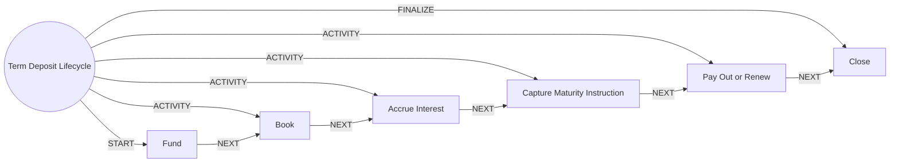

# Term Deposit Lifecycle

> Opens, accrues, matures and pays out fixed and recurring deposits.

## Use this process when
- fixed deposit
- FD
- recurring deposit
- RD
- maturity
- premature withdrawal

## Do not use it when
- savings or current account: use [Account Opening](account-opening.md)

## Trigger and ownership
- **Triggered by:** [Deposit opened](../events.md#evt.deposit_opened), [Maturity approaching](../events.md#evt.maturity_approaching)
- **Performed by:** [Operations Agent](../actors/agents.md#actor.operations_agent) (autonomy ceiling A3)
- **Escalates to:** [Operations Officer](../actors/humans-and-external.md#actor.operations_officer), [Service Officer](../actors/humans-and-external.md#actor.service_officer)
- **Emits:** none
- **Governed by:** [Authentication Assurance](../policies/authentication-assurance.md), [Consent and Privacy](../policies/consent-and-privacy.md), [Audit and Evidence](../policies/audit-and-evidence.md)

## Flow
Work the steps in order. At each step, open the linked activity file before acting. A step marked conditional is skipped when its condition is false, and the skip is recorded.

| # | Step | Edge | Activities | Performed by | Approval gate | Autonomy | Condition | What happens |
|---|---|---|---|---|---|---|---|---|
| 1 | **Fund** | START | [Check Limits and Balance](../activities/check-limits-and-balance.md), [Post to Ledger](../activities/post-to-ledger.md) | [Operations Agent](../actors/agents.md#actor.operations_agent) | none | A3 | always | Debit the source account and fund the deposit. |
| 2 | **Book** | ACTIVITY | inline | [Operations Agent](../actors/agents.md#actor.operations_agent) | none | A3 | always | Create the deposit with the rate card, tenure and maturity date. |
| 3 | **Accrue Interest** | ACTIVITY | inline | [Operations Agent](../actors/agents.md#actor.operations_agent) | none | A3 | always | Accrue interest in the daily close. |
| 4 | **Capture Maturity Instruction** | ACTIVITY | [Check Consent](../activities/check-consent.md), [Notify Customer](../activities/notify-customer.md) | [Operations Agent](../actors/agents.md#actor.operations_agent) | none | A3 | always | Remind the customer before maturity and record the instruction. Auto-renew needs recorded consent. |
| 5 | **Pay Out or Renew** | ACTIVITY | [Post to Ledger](../activities/post-to-ledger.md) | [Operations Agent](../actors/agents.md#actor.operations_agent) | none | A3 | always | Pay principal and interest or renew per the instruction. |
| 6 | **Close** | FINALIZE | inline | [Operations Agent](../actors/agents.md#actor.operations_agent) | none | A3 | always | Close the deposit and notify. |

## Graph edges
`proc.term_deposit_lifecycle` is the hub. Edges follow the hub-and-spoke pattern: the hub STARTs the first step, has an ACTIVITY edge to each middle step, FINALIZEs the last, and steps chain with NEXT.

## Exceptions
| If | Then |
|---|---|
| Premature closure | Show penalty, get explicit confirmation with step-up, then proceed. |
| Lien marked (e.g. loan security) | Block closure until the lien is released. |

## Finalize (done means)
Deposit paid out or renewed correctly with ledger postings.

## Data touched
| Object | Access | Backing tables |
|---|---|---|
| [Account](../objects/accounts-payments.md#obj.account) | reads | `bank_accounts`, `core_account_holders`, `gl_account_balances`, `ret_nominees` |
| [Product](../objects/engagement.md#obj.product) | reads | `core_products`, `core_interest_rates`, `core_fee_schedules`, `los_loan_products`, `ins_products` |
| [Customer](../objects/customer.md#obj.customer) | reads | `bank_customers`, `core_customer_contacts`, `bank_preferences`, `app_users` |
| [Term Deposit](../objects/accounts-payments.md#obj.term_deposit) | writes | `ret_term_deposits` |
| [Transaction](../objects/accounts-payments.md#obj.transaction) | writes | `bank_transactions` |
| [Journal Entry](../objects/accounts-payments.md#obj.journal_entry) | writes | `gl_journal_entries`, `gl_journal_lines`, `gl_posting_rules`, `gl_chart_of_accounts` |

## Evidence emitted
Event types from the activities above (see [Audit and Evidence](../policies/audit-and-evidence.md)): `payment.limits_checked`, `ledger.entry_posted`, `ledger.entry_reversed`, `consent.checked`, `notify.sent`, `notify.failed`.

## Related
- Related processes: [Account Opening](account-opening.md)
- Routing and event map: [routing.md](../routing.md)
